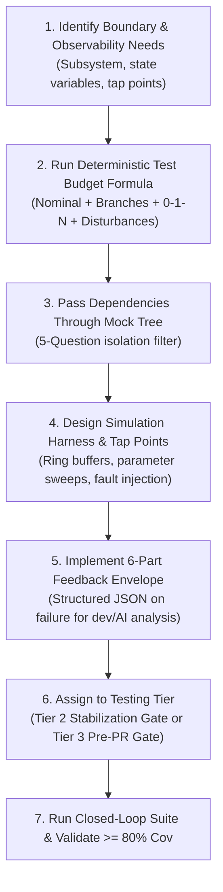
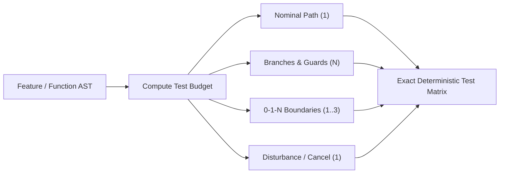
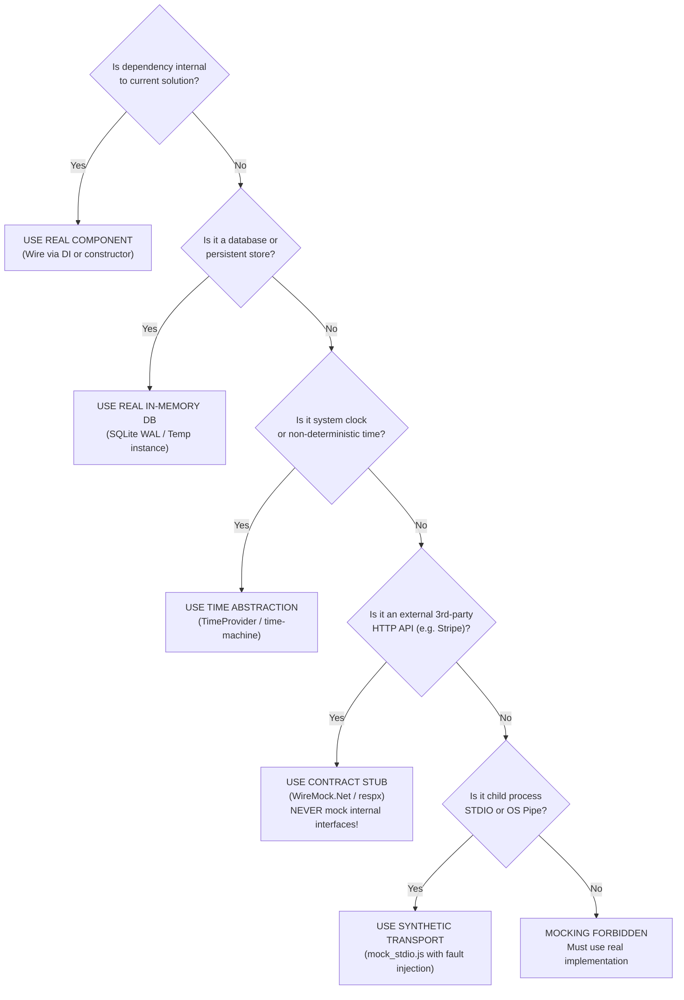

# Simulation and Control Harness Builder (`test-harness-builder`)

Use this skill when introducing a new API boundary, algorithmic module, state machine, dynamic subsystem, or frontend UI that requires closed-loop verification and observability.

This skill equips human engineers and AI agents to treat software as an observable dynamic system with state introspection and stress simulation.

---

## Harness Generation Workflow



---

## Mandatory Pre-Authoring Checklist

Execute these mandatory checks before writing any test or harness code:

### Deterministic Test Budget Formula

Analyze the target code Abstract Syntax Tree (AST) or specification to calculate the exact test budget:

```text
Test Budget = 1 (Nominal) + N_Branches + N_Boundaries (0-1-N) + N_Disturbances
```

1. **Nominal Path (1 test)**: Author one test for the happy path with valid data.
2. **Decision and Guard Branches (1 test per branch)**: Author one test per branch (`if`, `switch`, guard clause, or explicit `throw`).
3. **0-1-N Boundary Conditions (1 to 3 tests)**:
   - `0`: Test empty collections, null parameters, or zero values.
   - `1`: Test single elements or minimum boundary thresholds.
   - `N`: Test large collections, maximum limits, or pagination boundaries.
4. **Disturbances and Lifecycle (1 test if async or I/O)**:
   - For async routines: test `CancellationToken` cancellation and timeout recovery.
   - For state mutations: test idempotency under repeated calls.



### Deterministic Five-Question Mock Decision Tree

Pass every collaborator through the 5-question decision tree before adding any mock or stub:

1. **Is the dependency internal to the current solution?**
   - If yes: **Use the real component**. Wire it through dependency injection or direct instantiation.
2. **Is it a database or persistent store?**
   - If yes: **Use a real in-memory database** (SQLite in WAL mode or ephemeral test instance).
3. **Is it the system clock or non-deterministic time?**
   - If yes: **Use a time abstraction** (`TimeProvider` or `time-machine`).
4. **Is it an external third-party HTTP API (such as Stripe or SendGrid)?**
   - If yes: **Use a contract stub** (`WireMock.Net` or `respx`). Never mock internal interfaces.
5. **Is it child process STDIO or an OS pipe?**
   - If yes: **Use synthetic transport** (`mock_stdio.js`) with fault injection.

If you answer **"No"** to all five questions, **mocking is forbidden**. Use the real implementation.



---

## Anti-Test-Theatre Guardrails

Never author test theatre. Test theatre asserts mock interactions rather than real system behaviors.

| Dimension | Banned Anti-Pattern (Test Theatre) | Mandated Engineering Standard (Real Verification) |
| :--- | :--- | :--- |
| **1. Data Access & Persistence** | • Mocking `IRepository<T>` or `DbContext` to return static arrays.<br>• Asserting that `ExecuteAsync` received a specific SQL string.<br>• Ignoring real constraints (foreign keys, nullability, unique indexes). | • Execute real Dapper queries and migrations against an in-memory SQLite (WAL mode) database.<br>• Assert database state transitions directly (insert, mutate, query back, verify constraints). |
| **2. Service Wiring & Composition** | • Constructing classes with many mocked constructor parameters.<br>• Verifying internal method call chains rather than component behavior. | • Wire real dependencies through the application DI container.<br>• Exercise aggregate workflows end-to-end and verify system state deltas. |
| **3. Assertion Quality & Semantics** | • Asserting mock invocations (`mock.Verify`) as sole proof of success.<br>• Vague assertions (`Assert.NotNull`, `len > 0`, `status != 500`).<br>• Tautological assertions that use test helpers matching system bugs. | • Assert concrete state and schema invariants (`Assert.Equal`, exact payload diffs).<br>• Use 6-part feedback envelopes to capture exact `output_delta` on failure.<br>• Verify observable side effects (emitted events, committed rows). |
| **4. HTTP & Web APIs** | • Instantiating controller classes directly with mocked dependencies.<br>• Mocking middleware, authentication filters, or model validation.<br>• Skipping JSON serialization roundtrips. | • Execute full HTTP roundtrips via `WebApplicationFactory` or `httpx.AsyncClient`.<br>• Validate through routing, model binding, auth handlers, and serializers. |
| **5. CLI & Console Applications** | • Mocking `Console.ReadLine` or `sys.stdin` with fake memory streams.<br>• Asserting exit code `0` without inspecting output files or state. | • Execute real CLI binaries via subprocess execution against temporary workspace fixtures.<br>• Assert exact exit codes, `stdout`/`stderr` formatting, and filesystem changes. |
| **6. Async, Channels & Daemons** | • Using arbitrary sleep statements (`Thread.Sleep`, `asyncio.sleep`) to wait for background workers.<br>• Mocking `Channel<T>` or workers out of the test loop. | • Use deterministic synchronization (`WaitToReadAsync`, `ManualResetEventSlim`, or bounded polling).<br>• Drain in-memory queues and verify worker processing, retry, and cancellation. |
| **7. Error Handling & Fault Injection** | • Writing happy-path-only tests without simulating failures.<br>• Forcing mocks to throw generic exceptions unrepresentative of reality. | • Inject synthetic disturbances: malformed payloads, abrupt termination, socket timeouts, invalid tokens.<br>• Verify graceful degradation, standardized error payloads, and audit logs. |
| **8. Test Data & Fixtures** | • Randomly generated test data causing non-deterministic flaky failures.<br>• Massive, fragile 1,000-line JSON fixtures with mostly unused fields. | • Use deterministic test data builders with explicit random seeds.<br>• Specify only fields relevant to the test scenario; use valid domain defaults. |
| **9. Trivial & Boilerplate Testing** | • Testing auto-implemented properties, records, DTOs, or enum mappings to boost coverage metrics.<br>• Writing many tests for trivial pass-through routines. | • Do not write tests for boilerplate POCOs, DTOs, or auto-properties.<br>• Focus test budgets strictly on domain logic, edge cases, and integration boundaries. |
| **10. UI & Frontend Verification** | • Shallow unit testing of components where all child components and hooks are mocked to empty `<div>` tags.<br>• Snapshot testing large DOM trees that developers blindly accept. | • Run Playwright E2E journey tests against running frontend and backend instances.<br>• Enforce the 4-point `playwright-layout-inspector` audit (zero overflow, mobile fit, ≥ 24px targets, score ≥ 85). |
| **11. Configuration & Environments** | • Hardcoding environment variables or mocking `IConfiguration` with fake dictionaries.<br>• Tests that fail on different machines due to absolute local paths. | • Test configuration binding using real settings loading with temporary isolated environment overlays.<br>• Verify fallback behavior when required configuration keys are absent or invalid. |
| **12. Third-Party Network Boundaries** | • Mocking third-party APIs with hand-rolled mock behaviors that drift from real contracts.<br>• Making live outbound network requests during automated tests. | • Use WireMock.Net (.NET) or `respx` / `vcrpy` (Python) to replay recorded HTTP interactions.<br>• Restrict mocking strictly to external network edges; never mock internal boundaries. |

---

## Interactive Setup Protocol

Engage in proactive questioning to configure the harness:
1. **Target Component and System Boundary**: *"What specific subsystem, dynamic system, API boundary, or algorithm do you want to observe and control?"*
2. **Deterministic Test Budget and AST Branches**: *"How many decision branches, 0-1-N boundary conditions, and disturbance paths exist in this component?"*
3. **Collaborators and Five-Question Mock Evaluation**: *"What collaborators does this component depend on, and how does each pass the Five-Question Mock Decision Tree?"*
4. **Diagnostic Tap Points and Observability**: *"What internal state transitions, in-memory ring buffers, or UI `data-testid` anchors do developers and AI need to tap into?"*
5. **Simulation Loop and Parameter Sweeps**: *"What throughput target, iteration volume, or parameter sweep space should the simulation run?"*
6. **Disturbance Injection Modes**: *"What failure modes should we inject (abrupt socket disconnects, malformed payloads, latency spikes, cancellation storms)?"*
7. **Testing Tier and Gate Cadence**: *"Is this harness a Tier 2 stabilization gate before manual testing or a Tier 3 Pre-PR CI gate?"*

---

## Artifacts Generated

### High-Volume Simulation Harness and Parameter Sweeps

- **Backend and Services**: High-throughput execution loops measuring throughput, memory stability, and state convergence across parameterized sweeps.
- **Transports**: Synthetic child process STDIO (`mock_stdio.js`) or stream injectors.

### Disturbance Injection Suite

- Configurable synthetic disturbance triggers:
  - Abrupt process or socket disconnects and reconnection recovery.
  - Malformed or partial payload injection.
  - Injected latency spikes and timeout stress.
  - Clean `CancellationToken` teardown verification.

### Diagnostic Tap Points

- **In-Memory Ring Buffers**: Toggleable ring-buffer state getters (`DiagnosticTapRingBuffer`) capturing internal state transitions without polluting production logs.
- **Introspection Endpoints**: Debug tap points enabling developer and AI agent inspection during active execution.

### Frontend Playwright Driver and Layout Audit

- Standard `data-testid` attributes on interactive components.
- `tests/e2e/layout-audit.spec.ts` running the 4-point `playwright-layout-inspector` suite:
  - Zero horizontal overflow
  - Mobile viewport fit
  - Touch target ergonomics (**≥ 24px**)
  - Composite UX audit score (**≥ 85**)

### Standardized Six-Part Feedback Envelope

Failure formatting containing:
- `inputs` & `assumptions`
- `active_settings`
- `action_history` (state transitions)
- `output_delta` (expected vs. actual)
- `captured_logs`
- `reproduction_command`

### Representative Integration Fixtures

- **Web API**: Real `WebApplicationFactory` (.NET) or `httpx.AsyncClient` (Python) fixtures binding in-memory SQLite (WAL mode).
- **CLI Commands**: Subprocess test runners executing binaries in isolated temporary directories.
- **Contract Stubs**: WireMock.Net or `respx` recorded stubs for third-party HTTP endpoints.
