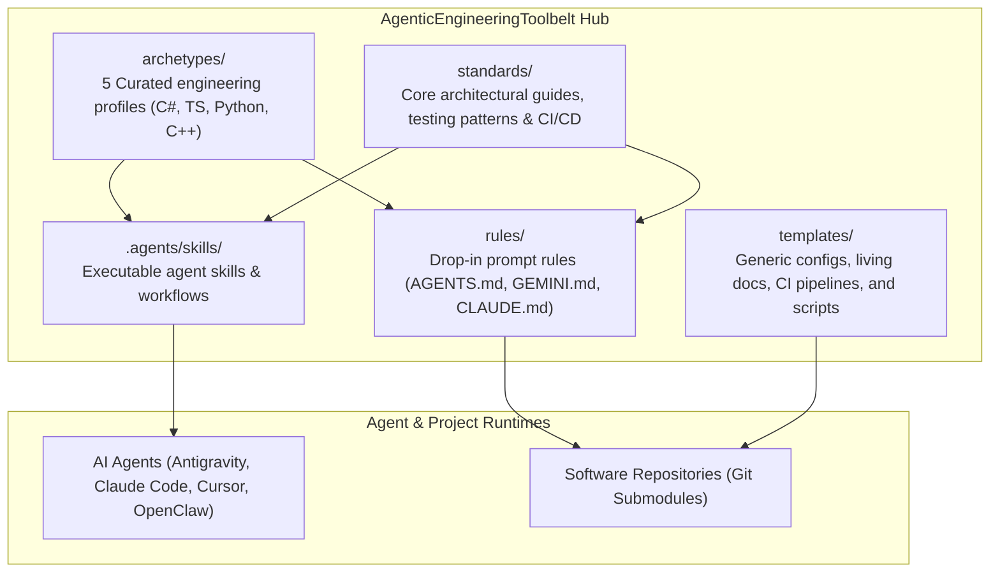

# AgenticEngineeringToolbelt

[](LICENSE)
[](https://github.com/spelech/AgenticEngineeringToolbelt)

> **Extensible engineering archetypes, architecture standards, controls-grade test harnesses, and AI agent tooling for high-velocity software engineering.**

`AgenticEngineeringToolbelt` establishes proven engineering standards, living documentation blueprints, and quality guardrails across software projects and AI agent runtimes (Antigravity, Claude Code, Cursor, OpenClaw, and Codex). Embed it as a **Git submodule** in repositories or install it directly into local AI agent skill directories.

---

## Toolbelt Architecture



---

## Modules and Documentation

| Module | Description | Key Documents |
| :--- | :--- | :--- |
| [**`ARCHITECTURE.md`**](ARCHITECTURE.md) | System topology, release lifecycle, and topic cross-linking map. | • [**Architecture & Documentation Map**](ARCHITECTURE.md#documentation-and-cross-linking-map) |
| [**`archetypes/`**](archetypes/README.md) | Curated polyglot engineering profiles. | • [**Fullstack (.NET + React + SQL)**](archetypes/fullstack-dotnet-react.md)<br>• [**C# Console & CLI**](archetypes/console-cli-dotnet.md)<br>• [**Python FastAPI & FastMCP**](archetypes/python-fastapi-mcp.md)<br>• [**React + TS + Vite UI**](archetypes/react-ts-vite-ui.md)<br>• [**Modern C++ Native Systems**](archetypes/native-cpp-algorithms.md) |
| [**`standards/`**](standards/) | Foundational engineering guidelines and testing patterns. | • [**Master Engineering Style Guide**](standards/ENGINEERING_STYLE_GUIDE.md)<br>• [**Simulation & Control Harnesses**](standards/TESTING_HARNESS_PATTERNS.md)<br>• [**Multi-Stage CI/CD Pipelines**](standards/CI_CD_PIPELINES.md) |
| [**`rules/`**](rules/) | Universal rule files for AI coding assistants. | • [**AGENTS.md**](rules/AGENTS.md) (Universal)<br>• [**GEMINI.md**](rules/GEMINI.md) (Antigravity)<br>• [**CLAUDE.md**](rules/CLAUDE.md) (Claude Code) |
| [**`.agents/skills/`**](.agents/skills/) | Executable agent skill definitions. | • [**`engineering-archetype`**](.agents/skills/engineering-archetype/SKILL.md)<br>• [**`scaffold-project`**](.agents/skills/scaffold-project/SKILL.md)<br>• [**`test-harness-builder`**](.agents/skills/test-harness-builder/SKILL.md) |
| [**`templates/`**](templates/) | Generic configuration boilerplates, workflows, and scripts. | • `configs/` (`Directory.Build.props`, `vite`, `tsconfig`, `eslint`, `playwright`, `vcpkg`, `pyproject`)<br>• `docs/` ([`ARCHITECTURE.md`](templates/docs/ARCHITECTURE.md), [`REQUIREMENTS.md`](templates/docs/REQUIREMENTS.md), [`CHANGELOG.md`](templates/docs/CHANGELOG.md))<br>• `workflows/` ([`ci.yml`](templates/workflows/ci.yml), [`codeql.yml`](templates/workflows/codeql.yml), [`release.yml`](templates/workflows/release.yml))<br>• `scripts/` ([`commit.sh`](templates/scripts/commit.sh), [`verify_release.py`](templates/scripts/verify_release.py)) |

---

## Quick Start and Integration

### Traditional Git Flow Model

All repositories adopting the toolbelt use traditional Git Flow:
- **`main`**: Production tagged releases (`vX.Y.Z`). Protected branch with no direct commits.
- **`develop`**: Integration branch for day-to-day feature work and agent iterations.
- **`feature/*`**: Dedicated feature branches off `develop`. Merge back to `develop` via Pull Request.
- **`release/*`**: Stabilization, version bumping, and changelog finalization off `develop`. Merge to both `main` and `develop`.
- **`hotfix/*`**: Urgent production fixes branching off `main`. Merge to both `main` and `develop`.

```bash
# Start a new feature branch
git checkout develop
git pull origin develop
git checkout -b feature/observable-simulation-engine

# Commit with Conventional Commits and open a Pull Request
git commit -m "feat(engine): add closed-loop simulation harness with tap points"
```

### Embed as a Git Submodule

Add the toolbelt to any repository to provide instant access to templates, rules, and standards:

```bash
git submodule add https://github.com/spelech/AgenticEngineeringToolbelt.git .toolbelt
git submodule update --init --recursive
ln -sf .toolbelt/rules/AGENTS.md AGENTS.md
```

### Install to Local Agent Skill Registries

Run the installer script to symlink skills into your local agent environments:

```bash
./scripts/install.sh
```

### Living Documentation Site

Host and browse project documentation, archetypes, and standards locally using VitePress:

```bash
npm install && npm run docs:dev
```

Deployments publish automatically to GitHub Pages via the [Multi-Stage CI/CD Pipeline](standards/CI_CD_PIPELINES.md).

### Agent System Prompt Reference

Include the following instruction in your agent prompt to align a session with the toolbelt:

> *"Always adhere to the engineering standards and archetypes codified in [AgenticEngineeringToolbelt](https://github.com/spelech/AgenticEngineeringToolbelt) (see [Master Engineering Style Guide](standards/ENGINEERING_STYLE_GUIDE.md))."*

---

## License

MIT © [Steven T. Pelech](LICENSE)
