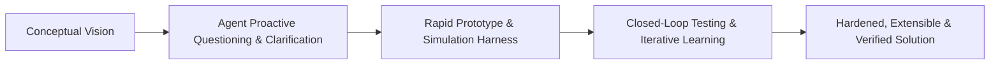

# Archetype: Fullstack (.NET + React + SQL) with Simulation and Control Harness

> **Architect**: Steven T. Pelech  
> **Focus**: Controls engineering, simulation, deterministic high-concurrency systems, and closed-loop testing for developers and AI.

---

## Collaboration and Iterative Design Model



### Proactive Clarification and Prototyping

- **Vision and Exploration**: Steven drives the conceptual vision, architecture, and feature ideas. Because ideas evolve during design, **the agent must ask insightful clarifying questions** to define requirements, edge cases, and design constraints.
- **Iterative Prototyping**: Build via rapid prototyping and closed-loop evaluation. Prototype early, run simulation harnesses, learn from live behavior, and refine the architecture iteratively.

### Traditional Git Flow Workflow

Follow [Traditional Git Flow Discipline](../standards/ENGINEERING_STYLE_GUIDE.md#traditional-git-flow-discipline):
- **`main`**: Production releases with immutable SemVer tags (`vX.Y.Z`).
- **`develop`**: Primary integration branch for verified feature work.
- **`feature/*`**: Feature branches branched from `develop` and merged back via Pull Request.
- **`release/*`**: Release stabilization branches branched from `develop` and merged into both `main` and `develop`.
- **`hotfix/*`**: Emergency production fixes branched from `main` and merged into both `main` and `develop`.

Create fine-grained, atomic Conventional Commits on each `feature/*` branch and verify that all [Multi-Stage CI/CD Pipeline](../standards/CI_CD_PIPELINES.md#git-flow-trigger-matrix) gates pass before merging.

---

## Core Architectural Tenets

### Architecture, Modularity, and APIs First

1. **Division of Labor**: Ask clarifying questions early and iterate with rapid prototypes.
2. **SOLID and DRY Modularity**: Keep classes and files focused and compact (**≤ 500 LOC**). Decompose multi-concern components into reusable, pluggable services (see [SOLID and Modularity](../standards/ENGINEERING_STYLE_GUIDE.md#solid-and-modularity)).
3. **APIs First, MCP Later**: Implement domain logic, schemas, and persistence inside typed APIs (Minimal APIs or Controllers) first. Expose Model Context Protocol (MCP) tools strictly as thin wrapper adapters second (see [APIs First, MCP Later](../standards/ENGINEERING_STYLE_GUIDE.md#apis-first-mcp-later)).
4. **Narrative Requirements and ADRs**: Write clear narrative acceptance criteria by default. Reserve formal `REQ-xxx` identifiers for projects that maintain formal Architecture Decision Record (ADR) catalogs.

### Simulation, Verification, and Coverage

5. **Controls and Simulation Mindset**: Build observable dynamic systems with diagnostic tap points (in-memory ring buffers), simulated transports (`mock_stdio.js`, SSE emulators), and loopback harnesses.
6. **Closed-Loop Feedback Envelopes**: Capture test failures in the standardized [Six-Part Agent Feedback Envelope](../standards/TESTING_HARNESS_PATTERNS.md#the-six-part-agent-feedback-envelope) to drive deterministic debugging.
7. **High Code Coverage**: Maintain **≥ 80% code coverage** across unit, integration, and end-to-end test suites using real implementations rather than mock-heavy test theatre.

### Security, AI Integration, and Delivery

8. **Traditional Git Flow and Atomic Commits**: Isolate work on `feature/*` branches with traceable atomic commits.
9. **Security and Encryption by Default**: Encrypt sensitive data at rest with self-contained **AES-256-GCM** symmetric encryption (avoiding OS-locked DPAPI or external vault dependencies) and enforce authentication and authorization.
10. **LLM Integration Standard**: Standardize LLM features on **LiteLLM / OpenAI SDK** compatibility for completions, streaming, embeddings, tool calling, and routing.
11. **Automated Documentation and Releases**: Maintain living Mermaid architecture diagrams and automate release verification via `verify_release.py` and GitHub Actions.

---

## Backend Architecture

### Solution Format and API Routing

- **Language and Runtime**: Modern .NET 10 (C#) with `<Nullable>enable</Nullable>`, `<ImplicitUsings>enable</ImplicitUsings>`, and `.slnx` solutions (see [Backend Architecture and Persistence](../standards/ENGINEERING_STYLE_GUIDE.md#backend-architecture-and-persistence)).
- **API Routing**: Choose **Controllers** (`[ApiController]`) for rich multi-route domain slices and **Minimal APIs** (`Map*Endpoints()`) for lightweight routes and streaming endpoints.

### Relational Persistence and Dapper

- Prefer relational SQL (SQLite WAL, MS SQL, or MySQL) over NoSQL or heavy ORMs.
- Use **Dapper** and ADO.NET with dedicated `.sql` **Stored Procedures** and parameterized queries via `IDbConnectionFactory`.
- Enable mandatory SQLite WAL pragmas (`PRAGMA journal_mode = WAL;`).
- Do not introduce Entity Framework Core or NoSQL document stores unless explicitly requested.

### Concurrency and Cancellation

- Manage concurrent state with `ConcurrentDictionary`, `Channel<T>`, and `SemaphoreSlim`.
- Propagate `CancellationToken` across all asynchronous database, I/O, and streaming operations.

---

## Frontend Architecture

### Zustand Stores and Selectors

- Build the UI with React, TypeScript in strict mode (`"strict": true`), and Vite (see [React, TypeScript & Vite UI Archetype](react-ts-vite-ui.md)).
- Organize **Zustand** stores (`use*Store.ts`) into separate domain slices and enforce granular selector hooks.

### CSS Tokens and Linter Policy

- Style components with pure CSS Modules and custom theme properties (`theme.css`) supporting dark mode.
- Enforce zero linter warnings in CI (`eslint . --max-warnings 0`).

---

## Testing and Simulation Harnesses

### Three-Tier Testing Cadence

Follow the [Tiered Testing Cadence](../standards/TESTING_HARNESS_PATTERNS.md#tiered-testing-cadence):
1. **Tier 1 (Inner Loop)**: Run fast unit tests (xUnit in C#; Vitest in TypeScript) on demand during active coding. Restrict test doubles strictly to external third-party edges.
2. **Tier 2 (Stabilization Gate)**: Run simulation harnesses, diagnostic tap point checks, and Playwright layout audits before manual verification.
3. **Tier 3 (Pre-PR & CI Gate)**: Execute multi-provider database matrices, live smoke gates, and the 4-stage CI pipeline before merging.

### Web API Integration Harness

Execute full HTTP roundtrips against a running test host using `WebApplicationFactory<Program>` and an in-memory SQLite database in WAL mode (see [C# Fullstack and CLI Harness Recipes](../standards/TESTING_HARNESS_PATTERNS.md#c-net-10-fullstack-and-cli)):

```csharp
public class ApiIntegrationTestBase : WebApplicationFactory<Program>
{
    private SqliteConnection _keepAliveConnection;

    protected override void ConfigureWebHost(IWebHostBuilder builder)
    {
        builder.ConfigureServices(services =>
        {
            var descriptor = services.SingleOrDefault(d => d.ServiceType == typeof(IDbConnectionFactory));
            if (descriptor != null) services.Remove(descriptor);

            _keepAliveConnection = new SqliteConnection("Data Source=:memory:;Mode=Memory;Cache=Shared");
            _keepAliveConnection.Open();

            services.AddSingleton<IDbConnectionFactory>(new SqliteConnectionFactory(_keepAliveConnection));

            var sp = services.BuildServiceProvider();
            var migrator = sp.GetRequiredService<IDatabaseMigrator>();
            migrator.MigrateUp();
        });
    }

    protected override void Dispose(bool disposing)
    {
        _keepAliveConnection?.Dispose();
        base.Dispose(disposing);
    }
}
```

### Controls Tooling and UI Layout Audits

- **Observable Tap Points**: Expose internal state transitions via event hooks and ring buffers (see [Diagnostic Tap Points](../standards/TESTING_HARNESS_PATTERNS.md#diagnostic-tap-points-and-agent-introspection)).
- **Synthetic Disturbance Transports**: Test disconnect recovery and latency resilience with `mock_stdio.js` (see [Harness Types and Simulation Patterns](../standards/TESTING_HARNESS_PATTERNS.md#harness-types-and-simulation-patterns)).
- **UI Layout Audits**: Enforce the 4-point `playwright-layout-inspector` audit (zero horizontal overflow, mobile viewport fit, touch targets ≥ 24px, and layout score ≥ 85; see [UI Layout Stability and Ergonomics Auditing](../standards/TESTING_HARNESS_PATTERNS.md#ui-layout-stability-and-ergonomics-auditing)).
