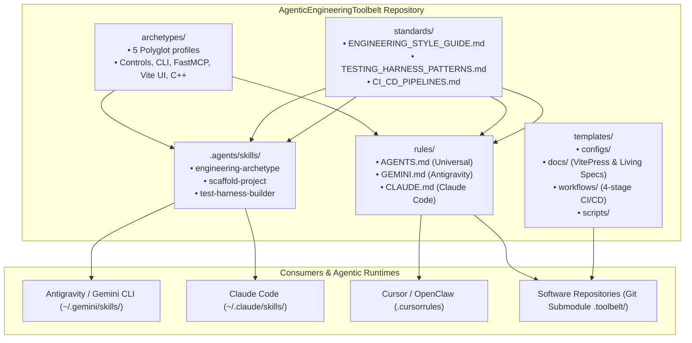
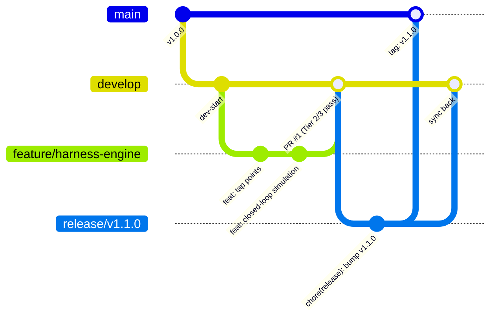
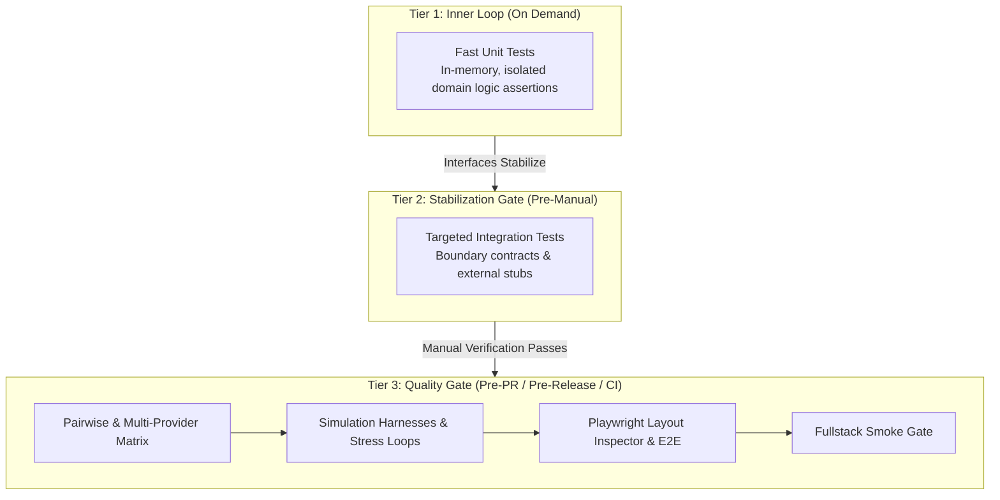

# System Architecture and Documentation Map

This document explains the organization, design principles, consumption topology, and documentation cross-linking map of **AgenticEngineeringToolbelt**.

---

## System Overview and Consumption Topology

---

## Subsystem Breakdown

### Curated Archetypes

The [`archetypes/`](/archetypes/) catalog codifies complete technology stacks, directory layouts, and verification recipes:
- [**Fullstack (.NET + React + SQL)**](/archetypes/fullstack-dotnet-react): C# .NET 10 Minimal APIs and Controllers, Dapper with stored procedures, SQLite WAL or MSSQL, and React with TypeScript and Zustand.
- [**C# Console & CLI**](/archetypes/console-cli-dotnet): C# .NET 10 command-line utilities using `System.CommandLine`, dependency injection, and subprocess test harnesses.
- [**Python FastAPI & FastMCP**](/archetypes/python-fastapi-mcp): Python 3.12+ services following the APIs First, MCP Later pattern with FastAPI, FastMCP, and Pydantic v2.
- [**React, TypeScript & Vite UI**](/archetypes/react-ts-vite-ui): Standalone React frontends with Zustand domain stores, CSS Modules, and Playwright layout audits.
- [**Modern C++ Native Systems**](/archetypes/native-cpp-algorithms): High-performance C++20/23 libraries using CMake or MSBuild, `vcpkg`, GoogleTest boundary sweeps, and C-ABI interop.

### Engineering Standards

The `standards/` directory provides canonical reference specifications for software design, testing, and delivery:
- [**Master Engineering Style Guide**](/standards/engineering-style-guide): Foundational SOLID principles, naming rules, APIs First architecture, and polyglot stack conventions.
- [**Simulation & Control Harnesses**](/standards/testing-harness-patterns): Observable dynamic system design, the Four Pillars of Anti-Test Theatre, deterministic test budgets, and 6-part feedback envelopes.
- [**Multi-Stage CI/CD Pipelines**](/standards/ci-cd-pipelines): Four-stage GitHub Actions quality gate specification mapped to Git Flow branch triggers.
- [**Technical Writing Standards**](/standards/asd-ste100): Simplified Technical English (ASD-STE100) and Google Developer Documentation Style Guide rules.

### Executable Agent Skills

The [`.agents/skills/`](/rules/skills) directory provides executable skill manifests for AI agent registries:
- [**`engineering-archetype`**](/rules/skills#engineering-archetype-skill): Guides agents on architectural standards, proactive clarification, and iterative verification.
- [**`test-harness-builder`**](/rules/skills#test-harness-builder-skill): Generates stress loops, synthetic STDIO transports, diagnostic tap points, and 6-part feedback envelopes.
- [**`scaffold-project`**](/rules/skills#scaffold-project-skill): Automates project scaffolding with Git Flow branches, VitePress docs, and 4-stage CI/CD workflows.

### Agent Context Rules

The [`rules/`](/rules/) directory contains drop-in prompt rule files that enforce engineering discipline:
- [**`AGENTS.md`**](/rules/agents): Universal markdown rules for any repository root.
- [**`CLAUDE.md`**](/rules/claude): Execution and verification context tailored for Claude Code.
- [**`GEMINI.md`**](/rules/gemini): Tool orchestration and context rules for Google Antigravity and Gemini CLI.

### Project Templates

The `templates/` directory supplies reusable configuration boilerplates, documentation starters, workflows, and verification scripts:
- **`configs/`**: `Directory.Build.props`, `vite.config.ts`, `tsconfig.json`, `eslint.config.js`, `playwright.config.ts`, `vcpkg.json`, and `pyproject.toml`.
- **`docs/`**: Starter `ARCHITECTURE.md`, `REQUIREMENTS.md`, `CHANGELOG.md`, and VitePress configuration.
- **`workflows/`**: Four-stage `ci.yml`, `codeql.yml`, `deploy-docs.yml`, and `release.yml`.
- **`scripts/`**: `commit.sh`, `git-flow-release.sh`, and `verify_release.py`.

---

## Traditional Git Flow and Release Model

### Branch Responsibilities

- **`main`**: Stores production tagged releases (`vX.Y.Z`) only. Direct commits are prohibited.
- **`develop`**: Serves as the integration branch for completed feature branches.
- **`feature/*`**: Branches off `develop` for isolated feature work and merges back via Pull Request.
- **`release/*`**: Branches off `develop` for version bumping and stabilization, then merges into `main` and `develop`.
- **`hotfix/*`**: Branches off `main` for urgent production fixes, then merges into both `main` and `develop`.

See the [Git Flow Trigger Matrix](/standards/ci-cd-pipelines#git-flow-trigger-matrix) for the exact CI stages executed per branch.

---

## Simulation and Controls Testing Cadence

See [Tiered Testing Cadence](/standards/testing-harness-patterns#tiered-testing-cadence) for detailed gate criteria across all three tiers.

---

## Documentation and Cross-Linking Map

Every guide in the toolbelt organizes topics under dedicated `H2` and `H3` headers so cross-links resolve to a single, specific section rather than spanning multiple headers.

### Standards Topic Map

| Document | Section Header | Core Topics Discussed | Primary Incoming Links |
| :--- | :--- | :--- | :--- |
| [**Master Style Guide**](/standards/engineering-style-guide) | [Collaboration & Iterative Design](/standards/engineering-style-guide#collaboration-and-iterative-design-model) | Clarifying questions, rapid prototyping, Git Flow discipline. | [`AGENTS.md`](/rules/agents#collaboration-and-workflow-discipline), [`fullstack-dotnet-react`](/archetypes/fullstack-dotnet-react#collaboration-and-iterative-design-model) |
| | [Foundational Engineering Principles](/standards/engineering-style-guide#foundational-engineering-principles) | SOLID (≤ 500 lines), DRY Rule of Three, role-based naming, APIs First. | [`AGENTS.md`](/rules/agents#core-code-and-architectural-discipline), [`python-fastapi-mcp`](/archetypes/python-fastapi-mcp#architectural-philosophy-apis-first-mcp-later) |
| | [Backend Architecture & Persistence](/standards/engineering-style-guide#backend-architecture-and-persistence) | .NET 10 `.slnx`, Dapper stored procedures, SQLite WAL pragmas, AES-256-GCM, channels. | [`fullstack-dotnet-react`](/archetypes/fullstack-dotnet-react#backend-architecture), [`console-cli-dotnet`](/archetypes/console-cli-dotnet#technology-stack) |
| | [Frontend Architecture](/standards/engineering-style-guide#frontend-architecture) | React, strict TypeScript, Zustand granular selectors, CSS Modules, Playwright audits. | [`react-ts-vite-ui`](/archetypes/react-ts-vite-ui#zustand-store-with-granular-selector-discipline), [`fullstack-dotnet-react`](/archetypes/fullstack-dotnet-react#frontend-architecture) |
| | [Testing & Simulation Harnesses](/standards/engineering-style-guide#testing-and-simulation-harnesses) | Controls mindset, anti-test theatre summary, tap points, 3-tier cadence, ≥ 80% coverage. | [`CLAUDE.md`](/rules/claude), [`GEMINI.md`](/rules/gemini) |
| [**Simulation & Control Harnesses**](/standards/testing-harness-patterns) | [The Four Pillars of Anti-Test Theatre](/standards/testing-harness-patterns#the-four-pillars-of-anti-test-theatre) | Real Over Mock, Outcomes Over Calls, Representative Dogfooding, Value Over Vanity. | [`engineering-style-guide`](/standards/engineering-style-guide#ban-on-mock-heavy-test-theatre), [`AGENTS.md`](/rules/agents#the-four-pillars-of-anti-test-theatre) |
| | [Banned & Mandated Patterns Matrix](/standards/testing-harness-patterns#banned-and-mandated-patterns-matrix) | 12 engineering dimensions grouped into Data/APIs (1–4), Runtime/Faults (5–8), and UI/Edges (9–12). | [`engineering-style-guide`](/standards/engineering-style-guide#ban-on-mock-heavy-test-theatre), [`AGENTS.md`](/rules/agents#the-four-pillars-of-anti-test-theatre) |
| | [Deterministic Test Budget Formula](/standards/testing-harness-patterns#deterministic-test-budget-formula) | AST-driven formula: `1 (Nominal) + Branches + Boundaries (0-1-N) + Disturbances`. | [`engineering-style-guide`](/standards/engineering-style-guide#anti-test-theatre-and-deterministic-budgets), [`AGENTS.md`](/rules/agents#deterministic-test-budget-formula) |
| | [Five-Question Mock Decision Tree](/standards/testing-harness-patterns#deterministic-five-question-mock-decision-tree) | Mechanical 5-step decision tree restricting mocks to external third-party edges. | [`engineering-style-guide`](/standards/engineering-style-guide#anti-test-theatre-and-deterministic-budgets), [`CLAUDE.md`](/rules/claude), [`GEMINI.md`](/rules/gemini) |
| | [The Six-Part Agent Feedback Envelope](/standards/testing-harness-patterns#the-six-part-agent-feedback-envelope) | Standardized JSON diagnostic payload (`inputs`, `assumptions`, `active_settings`, `action_history`, `output_delta`, `captured_logs`). | [`engineering-style-guide`](/standards/engineering-style-guide#standardized-six-part-feedback-envelope), [`AGENTS.md`](/rules/agents#coverage-ui-layout-audits-and-feedback-envelopes) |
| | [Polyglot Harness Recipes](/standards/testing-harness-patterns#polyglot-archetype-test-harness-recipes) | Concrete integration harness implementations for C#, Python, React/TS, and C++. | All 5 archetype guides and [`engineering-style-guide`](/standards/engineering-style-guide#anti-test-theatre-and-deterministic-budgets) |
| [**CI/CD Pipelines**](/standards/ci-cd-pipelines) | [Git Flow Trigger Matrix](/standards/ci-cd-pipelines#git-flow-trigger-matrix) & [Stage Descriptions](/standards/ci-cd-pipelines#stage-descriptions) | Branch-to-stage mapping across Integrity, Build & Test, Smoke, and Release gates. | [`engineering-style-guide`](/standards/engineering-style-guide#four-stage-github-actions-ci-cd-pipeline), [`ARCHITECTURE.md`](/architecture#traditional-git-flow-and-release-model) |
| [**Technical Writing Standards**](/standards/asd-ste100) | [Core Writing Rules](/standards/asd-ste100#core-writing-rules) & [Structural Rules](/standards/asd-ste100#structural-and-formatting-rules) | ASD-STE100 and Google Developer Documentation Style Guide rules, section-scoped links, clean numeric symbols. | [`engineering-style-guide`](/standards/engineering-style-guide#living-documentation-and-automation), [`AGENTS.md`](/rules/agents#technical-writing-and-living-documentation) |

---

## Non-Functional Guarantees

1. **Zero External Runtime Dependencies**: The toolbelt consists of portable Markdown, YAML, Shell, Python, and JSON configuration files.
2. **Submodule Safety**: Files use relative paths and template placeholders without hardcoded host filesystem paths.
3. **Multi-Agent Interoperability**: Manifests work natively across Antigravity, Claude Code, Cursor, Codex, and MCP gateways.
4. **Living Documentation Integrity**: Automated verification (`verify_release.py`) validates version synchronization, relative links, and section anchors on every commit.
