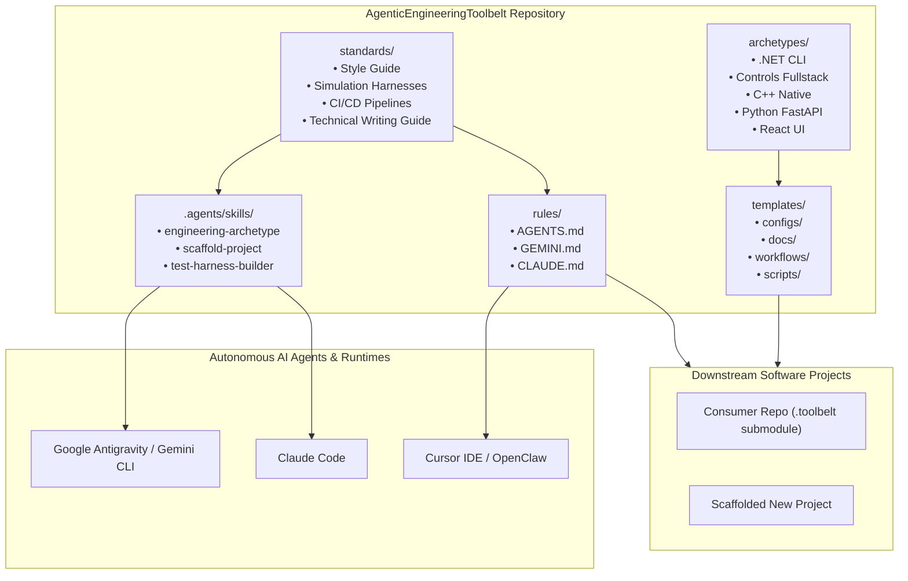

## System Architecture Topology

The following diagram illustrates how autonomous agents and consumer software repositories integrate the **AgenticEngineeringToolbelt**:



---

## Quickstart Guide

### Submodule Installation

Add the toolbelt as a Git submodule in any software repository and link the executable agent skills:

```bash
# Add the toolbelt as a git submodule
git submodule add https://github.com/spelech/AgenticEngineeringToolbelt.git .toolbelt
git submodule update --init --recursive

# Run the installation script to link agent skills
bash .toolbelt/scripts/install.sh
```

### Local Documentation Development

Launch the VitePress live documentation development server to preview guides and diagrams locally:

```bash
# Install dependencies
npm install

# Start local dev server
npm run docs:dev

# Build static assets
npm run docs:build
```

---

## Core Navigation

| Section | Focus Area | Primary Entry Points |
| :--- | :--- | :--- |
| **Architecture & Map** | Subsystem topology, Git Flow model, and cross-linking map. | [System Architecture & Documentation Map](/architecture) |
| **Engineering Standards** | Core architectural rules, simulation harnesses, and CI/CD gates. | [Master Engineering Style Guide](/standards/engineering-style-guide) • [Simulation & Control Harnesses](/standards/testing-harness-patterns) • [Multi-Stage CI/CD Pipelines](/standards/ci-cd-pipelines) |
| **Polyglot Archetypes** | Complete stack blueprints across C#, Python, TypeScript, and C++. | [Archetypes Catalog](/archetypes/) • [Fullstack (.NET + React)](/archetypes/fullstack-dotnet-react) • [.NET Console & CLI](/archetypes/console-cli-dotnet) • [Python FastAPI & FastMCP](/archetypes/python-fastapi-mcp) • [React, TS & Vite UI](/archetypes/react-ts-vite-ui) • [C++ Native Algorithms](/archetypes/native-cpp-algorithms) |
| **Agent Rules & Skills** | Drop-in agent context files and executable skill manifests. | [Rules & Context Overview](/rules/) • [Universal Agent Rules (AGENTS.md)](/rules/agents) • [Executable Skills](/rules/skills) |
