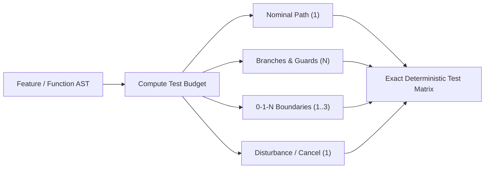
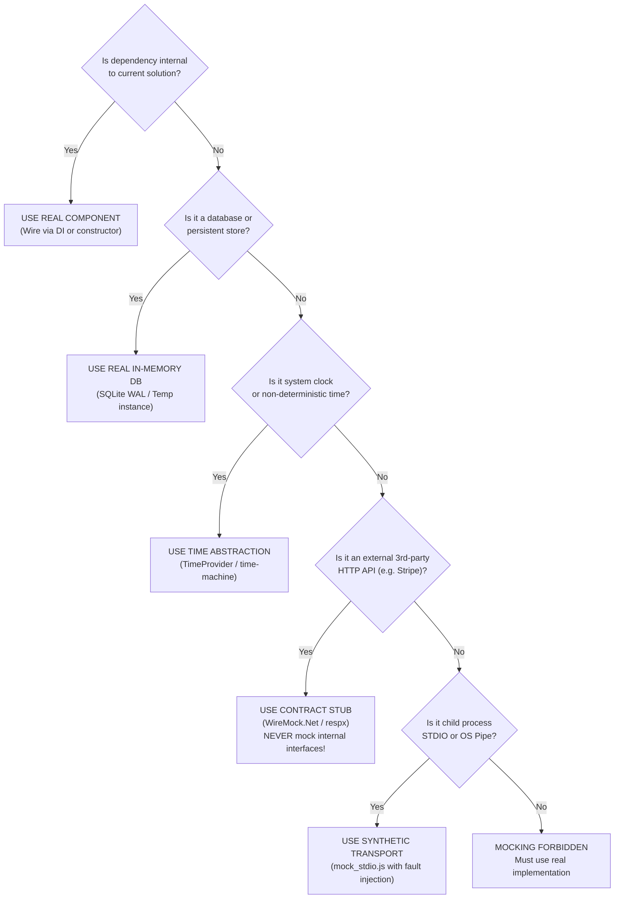

# Universal Agent Rules (AGENTS.md)

Mandatory architectural guidelines and execution rules for AI coding assistants.

---

## Collaboration and Workflow Discipline

### Proactive Clarification and Git Flow

1. **Proactive Clarifying Questions**: Steven's conceptual designs evolve during development. **Always ask insightful clarifying questions** to define requirements, edge cases, and architectural constraints.
2. **Traditional Git Flow Discipline** (see [Traditional Git Flow Discipline](/standards/engineering-style-guide#traditional-git-flow-discipline)):
   - **`main`**: Production tagged releases only (`vX.Y.Z`). Direct pushes are forbidden.
   - **`develop`**: Primary integration branch for ongoing work. Merge feature branches here through Pull Requests.
   - **`feature/*`**: Dedicated branches created off `develop` (`feature/feature-name`) for isolated work. Merge back to `develop` after Tier 2 and Tier 3 gates pass.
   - **`release/*`**: Created off `develop` (`release/vX.Y.Z`) for version bumping, changelog finalization, and release verification before merging into `main` and `develop`.
   - **`hotfix/*`**: Created directly off `main` (`hotfix/vX.Y.Z`) to fix critical production defects before merging into both `main` and `develop`.
   - Commit work using atomic **Conventional Commits** (`feat:`, `fix:`, `test:`, `docs:`, `chore:`).
   - Open a Pull Request and verify that all [Multi-Stage CI/CD Pipeline](/standards/ci-cd-pipelines#git-flow-trigger-matrix) gates pass before merging.

### Technical Writing and Living Documentation

Write all user-facing documentation, README files, architectural specs, and living guides according to our [Technical Writing Standards](/standards/asd-ste100), combining **ASD-STE100 (Simplified Technical English)** and the **Google Developer Documentation Style Guide**:
- Keep sentences short, concise, and direct (**≤ 25 words per sentence**).
- Use active voice and second-person imperative mood for instructions.
- Organize dense topics into scannable `H2` and `H3` headings and scope cross-links to exact `#section` anchors.
- Use standard Unicode symbols (`≥`, `≤`) instead of raw LaTeX math syntax in prose.
- Render architecture, sequence, state, and branching diagrams using native **Mermaid syntax** (`flowchart TD`, `sequenceDiagram autonumber`, `stateDiagram-v2`, `gitGraph`).
- Publish living documentation via **VitePress** deployed to GitHub Pages.

### APIs First and Container Immutability

1. **APIs First, MCP Later** (see [APIs First, MCP Later](/standards/engineering-style-guide#apis-first-mcp-later)):
   - Implement domain logic and workflows inside clean, typed, self-contained libraries and REST/gRPC APIs before exposing them via Model Context Protocol (MCP).
   - Keep MCP tools strictly as lightweight wrappers that forward requests to underlying service interfaces.
   - Ensure core capabilities remain 100% testable through CLI, direct API calls, or integration harnesses without requiring MCP.
2. **Container Immutability**:
   - **Never** edit files or hot-patch code inside live running containers.
   - Always rebuild via standard compose commands (`docker compose up -d --build`) or pull official images.
3. **Container Target Architecture**:
   - Standardize strictly on native `linux/amd64` for all container builds and CI workflows.
   - Do not include QEMU emulation or multi-architecture (`arm64`) build steps in CI/CD pipelines.

---

## Core Code and Architectural Discipline

### Modularity, Interfaces, and DRY

1. **SOLID and File Size Limit**: Decompose files and classes exceeding **500 lines of code (≤ 500 LOC)** into partial classes or focused sub-services (see [SOLID and Modularity](/standards/engineering-style-guide#solid-and-modularity)).
2. **Interfaces by Default**: Build client-focused interfaces (`I*` in C#) even for single implementations to ensure loose coupling and testability.
3. **DRY vs. YAGNI**:
   - **Rule of Three**: Permit duplication across two instances; refactor into a shared abstraction on the third occurrence.
   - Do not invent speculative multi-tier frameworks (YAGNI).

### Semantic Naming and Anti-Pattern Bans

- **Banned**: Never create `*Manager`, `*Helper`, `*Util`, or `*Data` junk-drawer classes (see [Semantic Naming and Anti-Pattern Bans](/standards/engineering-style-guide#semantic-naming-and-anti-pattern-bans)).
- **Enforced**: Use role- and action-based names (`DatabaseSeederService`, `UserAuthenticator`, `ServerStatusCard`, `use*Store.ts`).

### Database, Frontend, and Error Handling

1. **Database Efficiency**: Consolidate operations requiring three or more database round-trips or complex multi-table joins into a single **Stored Procedure** (`.sql` file) or batch query.
2. **Frontend Selectors**: Use **granular Zustand selectors** (`useServerStore(s => s.servers.length)`) to prevent render cascades.
3. **Error Handling and Diagnostics**: Never leak raw stack traces to API clients. Log structured debug payloads with the exact inputs and state that triggered the failure.

---

## Polyglot Language Matrix

| Stack | Core Conventions & Tooling | Archetype Blueprint |
| :--- | :--- | :--- |
| **C# (.NET 10)** | `.slnx`, `System.CommandLine`, full DI, Dapper + Stored Proc `.sql` files, SQLite WAL / MSSQL, native C# UIs (WPF/WinForms/Avalonia, no Electron), full `CancellationToken` propagation. | [Fullstack (.NET + React)](/archetypes/fullstack-dotnet-react) • [.NET Console & CLI](/archetypes/console-cli-dotnet) |
| **Python (3.12+)** | `uv`, `pyproject.toml`, FastAPI + FastMCP, Pydantic v2 schemas, `asyncio`, `pytest` (≥ 80% coverage), `ruff`. | [Python FastAPI & FastMCP](/archetypes/python-fastapi-mcp) |
| **TypeScript / React** | React + strict TS + Vite, Zustand domain stores, pure CSS Modules + custom properties, `playwright-layout-inspector` 4-point audit. | [React, TS & Vite UI](/archetypes/react-ts-vite-ui) |
| **C++ (C++20/23)** | MSBuild (Win) / CMake (Linux), `vcpkg`, strict RAII, smart pointers, GoogleTest (`gtest`), ASan/UBSan, Benchmark, C# `[LibraryImport]` / Python `pybind11` interop. | [C++ Native Algorithms](/archetypes/native-cpp-algorithms) |

---

## Testing and Agent Verification Protocol

### Observable Systems and Tiered Cadence

1. **Software as an Observable Dynamic System**:
   - Model critical workflows, boundary crossings, and stateful protocols with diagnostic tap points, metrics, and health probes.
   - Build closed-loop simulation harnesses with high-volume stress loops, parameter sweeps, and synthetic disturbance ingestion.
2. **Tiered Testing Cadence** (see [Tiered Testing Cadence](/standards/testing-harness-patterns#tiered-testing-cadence)):
   - **Tier 1 (Inner Loop)**: Run fast, isolated in-memory unit tests on demand during active development.
   - **Tier 2 (Stabilization Gate)**: Run unit and targeted integration suites once feature interfaces stabilize, immediately before manual verification.
   - **Tier 3 (Pre-PR & CI Gate)**: Execute the full test matrix, multi-provider integration suites, simulation stress loops, and Playwright layout audits before merging.

### The Four Pillars of Anti-Test Theatre

Never write **Test Theatre** (mock-heavy tests that verify method calls instead of real system state). Enforce the [Four Pillars of Anti-Test Theatre](/standards/testing-harness-patterns#the-four-pillars-of-anti-test-theatre) and the 12-dimension [Banned and Mandated Patterns Matrix](/standards/testing-harness-patterns#banned-and-mandated-patterns-matrix):

1. **Pillar 1: Real Over Mock**: Test software with real components and in-memory SQLite (WAL mode) databases instead of mocking `IRepository<T>` or `DbContext`. Mock only unmanageable external third-party network boundaries.
2. **Pillar 2: Outcomes Over Calls**: Assert observable state deltas (database records, generated files, response payloads, emitted events). Never use `mock.Verify()` as primary proof of success.
3. **Pillar 3: Representative Dogfooding**: Execute a real CLI subprocess or full HTTP request-response roundtrip for every feature before claiming completion.
4. **Pillar 4: Value Over Numeric Vanity**: Prioritize boundary conditions, disturbances, and concurrency over shallow line coverage. Do not write tests for boilerplate POCOs, DTOs, or auto-properties.

```mermaid
flowchart TD
    subgraph P1["Pillar 1: Real Over Mock"]
        direction TB
        R1["Real In-Memory DBs<br>(SQLite WAL / Ephemeral)"]
        R2["Real DI Containers & Service Wiring"]
        R3["Strict Boundary Isolation<br>(Mocks ONLY at 3rd-party edge)"]
    end

    subgraph P2["Pillar 2: Outcomes Over Calls"]
        direction TB
        O1["Observable State Deltas (DB rows, files)"]
        O2["Return Payloads & Invariants"]
        O3["BANNED: Mock.Verify() as primary assertion"]
    end

    subgraph P3["Pillar 3: Representative Dogfooding"]
        direction TB
        D1["Full HTTP Pipeline Roundtrips"]
        D2["Real CLI Subprocess Execution"]
        D3["Playwright E2E User Journeys"]
    end

    subgraph P4["Pillar 4: Value Over Vanity"]
        direction TB
        V1["Basis Path & Boundary Sweeps (0-1-N)"]
        V2["Synthetic Disturbance Ingestion"]
        V3["BANNED: Testing trivial POCOs for % metrics"]
    end

    P1 --> RealSystem["Deterministic, High-Confidence Software"]
    P2 --> RealSystem
    P3 --> RealSystem
    P4 --> RealSystem
```



### Deterministic Test Budget Formula

Analyze the function or feature Abstract Syntax Tree (AST) before authoring tests to compute the exact required budget (see [Deterministic Test Budget Formula](/standards/testing-harness-patterns#deterministic-test-budget-formula)):

```text
Test Budget = 1 (Nominal) + N_Branches + N_Boundaries (0-1-N) + N_Disturbances
```

- **Nominal Path (1 test)**: One test exercising the happy path with valid nominal data.
- **Decision and Guard Branches (1 test per branch)**: One test per independent branch (`if`, `switch`, validation guard, or explicit `throw`).
- **0-1-N Boundary Conditions (1 to 3 tests)**: `0` (empty/null/zero), `1` (single item/minimum), and `N` (large batch/maximum).
- **Disturbances and Lifecycle (1 test if async or stateful)**: One test validating `CancellationToken` propagation, timeout recovery, or state idempotency.



### Deterministic Five-Question Mock Decision Tree

Pass every candidate collaborator through the [Five-Question Mock Decision Tree](/standards/testing-harness-patterns#deterministic-five-question-mock-decision-tree) before creating any mock or stub:

1. **Is the dependency internal to the current solution?** If yes, use the real component via dependency injection or direct instantiation.
2. **Is it a database or persistent store?** If yes, use a real in-memory database (SQLite WAL or ephemeral instance).
3. **Is it the system clock or non-deterministic time?** If yes, use a time abstraction (`TimeProvider` or `time-machine`).
4. **Is it an external third-party HTTP API (such as Stripe or SendGrid)?** If yes, use a contract stub (`WireMock.Net` or `respx`). Never mock internal interfaces.
5. **Is it child process STDIO or an OS pipe?** If yes, use a synthetic transport (`mock_stdio.js`) with fault injection.

If you answer **"No"** to all five questions, **mocking is forbidden**. Use the real implementation.



### Coverage, UI Layout Audits, and Feedback Envelopes

1. **Coverage Target**: Maintain **≥ 80% code coverage** across unit, integration, and end-to-end suites, excluding trivial POCO and DTO boilerplate.
2. **UI Layout Inspection**: Verify that frontends pass the 4-point `playwright-layout-inspector` audit (zero overflow, mobile fit, ≥ 24px touch targets, ≥ 85 layout score; see [UI Layout Stability and Ergonomics Auditing](/standards/testing-harness-patterns#ui-layout-stability-and-ergonomics-auditing)).
3. **Six-Part Agent Feedback Envelope**: Format all harness or test failures using the [Six-Part Agent Feedback Envelope](/standards/testing-harness-patterns#the-six-part-agent-feedback-envelope) (`inputs`, `assumptions`, `active_settings`, `action_history`, `output_delta`, `captured_logs`, and `reproduction_command`).
4. **Empirical Verification**: Never claim a task is complete without running builds, executing tests, inspecting logs, and probing `/health`.
