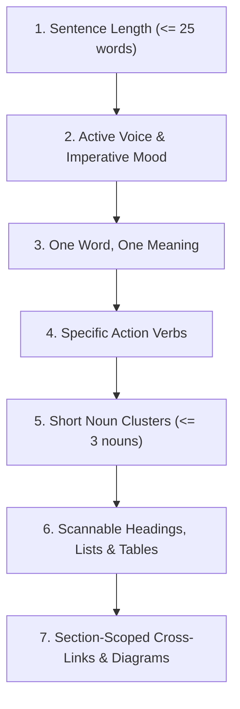

# Technical Writing Standards: ASD-STE100 and Google Developer Style

This guide defines the technical writing, structural, and formatting standards for **AgenticEngineeringToolbelt** and all downstream projects (see [Living Documentation and Automation](/standards/engineering-style-guide#living-documentation-and-automation)).

---

## Purpose and Style Foundations

### ASD-STE100 Simplified Technical English

ASD-STE100 reduces linguistic complexity so both human engineers and autonomous AI agents can parse specifications without ambiguity:
- Keep procedural sentences under **25 words**.
- Restrict each term to a single, unambiguous technical meaning.
- Express one instruction or requirement per sentence.

### Google Developer Documentation Style Guide

Google Developer Documentation conventions ensure scannable structure, accessible navigation, and reliable cross-linking:
- Address the reader in the second person (**"you"**) or use imperative verbs.
- Organize dense topics into hierarchical `H2` (`##`) and `H3` (`###`) headings for left-rail and right-rail navigation.
- Write descriptive link text that targets a single specific section anchor (`#section-slug`) rather than linking across multiple headers.
- Avoid leading numbers, ampersands (`&`), or emojis in section headings so Markdown anchor slugs resolve identically across VitePress and GitHub.

---

## Core Writing Rules

### Rule 1: Keep Sentences Short

- Limit sentences to **20 to 25 words**.
- Express only **one complete thought** per sentence.
- Split compound sentences into bulleted lists or sequential steps.

### Rule 2: Use Active Voice and Imperative Mood

- State clearly who or what performs the action.
- Begin procedural instructions with an imperative verb.
- Avoid passive voice constructions.

| Passive Form (Do Not Use) | Active / Imperative Form (Approved) |
| :--- | :--- |
| The unit test suite is executed by the CI runner. | The CI runner executes the unit test suite. |
| Configuration parameters should be validated. | Validate all configuration parameters before execution. |
| The ring buffer is read by the simulation harness. | The simulation harness reads the ring buffer. |

### Rule 3: One Word for One Meaning

- Select one canonical technical term and use it consistently.
- Do not alternate between synonyms to vary writing style.
- Match documentation terms to codebase class and interface names.

| Inconsistent Synonyms (Do Not Use) | Canonical Term (Approved) |
| :--- | :--- |
| harness / test loop / runner / driver | **Simulation Harness** |
| endpoint / action / route / path | **API Route** |
| tap point / hook / probe / monitor | **Diagnostic Tap Point** |

### Rule 4: Eliminate Vague Verbs

- Do not use generic verbs such as *make*, *do*, *get*, or *deal with*.
- Choose precise verbs that describe the exact system operation.

| Vague Phrase (Do Not Use) | Precise Replacement (Approved) |
| :--- | :--- |
| Make a new connection to SQL | Connect to the SQL server |
| Do a check on input parameters | Validate all input parameters |
| Get data from cache | Retrieve records from the cache |
| Deal with error conditions | Handle timeout exceptions |

### Rule 5: Limit Noun Clusters

- Do not string more than **three consecutive nouns** together.
- Use prepositions to clarify relationships between components.

| Dense Noun Cluster (Do Not Use) | Clarified Phrase (Approved) |
| :--- | :--- |
| order processing queue worker thread | worker thread for the order processing queue |
| client state event listener registry | registry of event listeners for client state |

---

## Structural and Formatting Rules

### Scannable Headings and Lists

- Break dense paragraphs and long tables into focused `H2` (`##`) and `H3` (`###`) subsections so every topic appears in the right-side "On this page" outline.
- Use **numbered lists** for sequential procedures.
- Use **bulleted lists** or **tables** for unordered options, rules, and comparisons.
- Write headings using plain words (`and` instead of `&`, no leading emojis or numbers) to produce clean, deterministic anchor slugs.

### Section-Scoped Cross-Linking

- Link directly to the specific target section (`[Five-Question Mock Decision Tree](/standards/testing-harness-patterns#deterministic-five-question-mock-decision-tree)`) instead of linking only to the top of a multi-section document.
- Never combine topics from separate headers into a single ambiguous link. Give each referenced topic its own descriptive link and section anchor.

### Numeric Symbols and Formula Formatting

- Do not use raw LaTeX math delimiters (`$...$`, `$$...$$`, `\ge`, `\le`, `\text{...}`) in Markdown prose or tables, as standard Markdown and VitePress render them as literal text unless a math compiler is active.
- Use standard Unicode symbols (**`≥`**, **`≤`**) or clear English phrases (*"at least 80%"*, *"500 lines or fewer"*) in body text and tables.
- Format multi-term equations inside fenced `text` code blocks or bold inline expressions:
  `Test Budget = 1 (Nominal) + N_Branches + N_Boundaries (0-1-N) + N_Disturbances`

### Mermaid Visual Diagrams

- Accompany complex topologies, state machines, and workflows with native **Mermaid diagrams** (`flowchart TD`, `flowchart LR`, `sequenceDiagram autonumber`, `stateDiagram-v2`, `gitGraph`).
- Do not place HTML entities (`&ge;`, `&lt;`, `&gt;`) inside Mermaid node labels; use plain ASCII (`>=`, `<=`) or Unicode (`≥`, `≤`).

---

## Verification Checklist

Verify the following criteria before opening a Pull Request:
- [ ] Every sentence contains 25 words or fewer.
- [ ] All procedural steps use active, imperative verbs.
- [ ] Dense sections are decomposed into `H2` and `H3` headings visible in right-side navigation.
- [ ] Cross-links use descriptive text and resolve to exact `#section` anchors.
- [ ] Zero raw LaTeX delimiters (`$\ge$`, `$\le$`, `$$`) or broken HTML entities exist in prose or diagrams.
- [ ] `python3 templates/scripts/verify_release.py --ci` passes with zero broken links or anchors.
