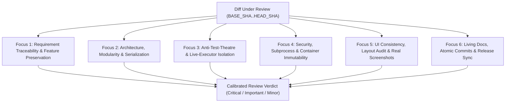

# Code Review Foci, Requirements Traceability, and Operational Guardrails

This standard defines the multi-lens code review foci, formal requirement-to-test traceability conventions, and operational repository guardrails that keep agentic engineering fast, deterministic, and reliable.

---

## Multi-Lens Code Review and The Six Reviewer Foci

Single-pass code reviews frequently miss deep architectural, security, or test-theatre defects when a reviewer skims a large diff. Perform code reviews across **six orthogonal reviewer foci**. Each focus evaluates a specific engineering dimension against the diff range (`BASE_SHA..HEAD_SHA`) and requires `file:line` evidence for every finding.



### Focus 1: Requirement Traceability and Feature Preservation

Verify that the implementation fulfills the requested scope without silent regressions or unrequested removals:

- **Requirement Metadata on Tests**: Every new or modified test across backend unit/integration suites, frontend component suites, and E2E suites carries a formal requirement annotation (`[Requirement(...)]`, `@requirement`, or pytest marker) using the standard category taxonomy (`AUTH`, `DB`, `GUARD`, `MCP`, `SEC`, `TRANS`, `UI`).
- **SRS Catalog Synchronization**: When tests or requirements change, the living requirements specification (`REQUIREMENTS.md` or generated SRS catalog) updates in lockstep with zero drift.
- **Feature Preservation**: Never remove or disable existing features, endpoints, or configuration options unless the user explicitly instructs you to remove them.
- **Zero Legacy Shims**: Delete dead code paths cleanly when replacing an implementation rather than leaving unused compatibility shims.

### Focus 2: Architecture, Modularity, and Safe Serialization

Verify structural boundaries and data-handling discipline (see [Master Engineering Style Guide](/standards/engineering-style-guide#foundational-engineering-principles)):

- **File and Class Size Cap**: Every file and class stays at or below **500 lines of code** (`≤ 500` lines). Split classes exceeding this threshold into focused sub-services or partial classes.
- **Client-Focused Interfaces and Semantic Naming**: Domain services expose client-focused interfaces (`I*` in C#, `Protocol` in Python). Reject generic junk-drawer names (`*Manager`, `*Helper`, `*Util`, `*Data`).
- **APIs First, MCP Later**: Core domain logic resides in standalone, strongly typed services and REST/gRPC APIs. Model Context Protocol (MCP) tools act strictly as thin wrapper adapters using `<serverId>__<toolName>` namespacing.
- **Structured JSON and Payload Manipulation**: Never use string manipulation (`string.Replace`, `Substring`, regex splicing) to rewrite JSON or JSON-RPC payloads. Always parse and mutate payloads through typed DOM/AST structures (`JsonNode`, `JsonObject`, `JsonDocument` in C#; Pydantic v2 models in Python).

### Focus 3: Anti-Test-Theatre and Live-Executor Isolation

Verify that automated tests prove real system behavior rather than mock wiring (see [Simulation and Control Harnesses](/standards/testing-harness-patterns#observable-dynamic-systems-and-the-four-pillars)):

- **Real Components Over Internal Mocks**: Integration and repository tests execute against real in-memory or ephemeral SQLite WAL databases, real dependency injection containers, and real in-process HTTP/MCP transports (`WebApplicationFactory`, `httpx.AsyncClient`, `InMemorySessionClient`).
- **Boundary and Budget Alignment**: Tests cover `0-1-N` boundaries and match the [Deterministic Test Budget Formula](/standards/testing-harness-patterns#deterministic-test-budget-formula) (`1 Nominal + N_Branches + N_Boundaries + N_Disturbances`) with `≥ 80%` line and branch coverage.
- **Outcomes Over `.Verify()` Dominance**: Assert observable state mutations, returned payloads, and database records rather than mock `.Verify()` call counts.
- **Pristine Output and Live-Marker Isolation**: Test suites emit zero linter or compiler warnings (`eslint --max-warnings 0`, `ruff check`). Tests that invoke external CLIs or live network endpoints are isolated behind explicit markers (`pytest -m "not live"`) so automated runs never spawn runaway child processes.

### Focus 4: Security, Subprocess Safety, and Container Immutability

Verify runtime safety, secret protection, and deployment immutability:

- **Sanitized Subprocess Execution**: Pass CLI arguments strictly as sanitized argument arrays (`subprocess.run(["cmd", arg1], capture_output=True, timeout=...)`) with explicit non-blocking timeouts. Using `shell=True` or unsanitized string interpolation is forbidden.
- **End-to-End Cancellation Propagation**: Propagate `CancellationToken` (C#) or async timeouts (Python/TypeScript) across 100% of database, HTTP, subprocess, and channel operations.
- **Encryption at Rest and Secret Hygiene**: Persist sensitive credentials in encrypted storage (AES-256-GCM or Vaultwarden/Vault integration)—never in plaintext config files or hardcoded source strings. Verify `.gitignore` excludes `*.db`, `*.key`, `.env`, `venv/`, and runtime `data/` directories.
- **Container Immutability**: Never hot-patch or edit files inside running containers (`docker cp`, interactive container edits). All runtime changes flow through clean image builds and `docker compose up -d` recreation.

### Focus 5: UI Consistency, Layout Stability, and Real Screenshots

Verify frontend ergonomics and visual evidence (see [UI Layout Stability and Ergonomics Auditing](/standards/testing-harness-patterns#ui-layout-stability-and-ergonomics-auditing)):

- **Design Tokens and Granular State Selectors**: Styles consume centralized CSS custom properties (`variables.css` / `theme.css`) rather than hardcoded hex values. Zustand stores use granular selectors (`useStore(s => s.items.length)`) to prevent render cascades.
- **Layout Jump Prevention**: Top-level containers prevent vertical and horizontal layout shifts across tab changes (`align-items: flex-start` on body containers and `scrollbar-gutter: stable` on the `html` element).
- **Four-Point Layout Audit**: Every primary view and modal passes `playwright-layout-inspector` checks (`toHaveNoLayoutOverflow`, `toHaveMobileFit`, `toHaveTouchFriendlyTargets({ minSize: 24 })`, `toPassLayoutAudit({ minScore: 85 })`).
- **Real Application Screenshots Only**: Capture all documentation images and UI pull request screenshots from the live running application using Playwright or Puppeteer. AI-generated mockups or placeholder images are forbidden.

### Focus 6: Living Documentation, Atomic Commits, and Release Sync

Verify documentation accuracy, commit hygiene, and release readiness (see [Multi-Stage CI/CD Pipelines](/standards/ci-cd-pipelines#git-flow-trigger-matrix)):

- **Living Documentation Sync**: Every feature or architectural change updates `README.md`, `ARCHITECTURE.md`, and VitePress guides (`docs/`) in the same branch.
- **Technical Writing and Link Integrity**: Prose follows [Technical Writing Standards](/standards/asd-ste100#core-writing-rules) (active voice, native Mermaid diagrams, Unicode numeric symbols `≥` and `≤`, and section-scoped `#anchor` links).
- **Atomic Conventional Commits**: Changes are grouped into logical, single-concern commits using Conventional Commit prefixes (`feat:`, `fix:`, `test:`, `docs:`, `chore:`).
- **Lockstep Versioning and CI Gate Verification**: Code changes synchronize version numbers across all manifests and `CHANGELOG.md` (respecting the documentation-only exception below), and all GitHub Actions CI workflows pass before the PR is finalized.

---

## Requirements Traceability and Living SRS Catalogs

High-reliability repositories maintain a 1:1 traceability link between software requirements in `REQUIREMENTS.md` and automated test proofs across backend, frontend, and E2E suites.

### Category Taxonomy and Requirement Identifiers

Assign every requirement a deterministic identifier using `<CATEGORY>-<NN>` format. Do not use generic `REQ-` prefixes when domain category codes apply:

| Category Code | Domain Scope | Example ID | Typical Verification Layer |
| :--- | :--- | :--- | :--- |
| **`AUTH`** | Authentication, SSO, RBAC, and session lifecycle | `AUTH-01` | Integration / API harness |
| **`DB`** | Schema migrations, SQLite WAL / SQL persistence, encryption at rest | `DB-01` | Repository test against real DB |
| **`GUARD`** | Fail-closed guardrails, rate limits, timeout/cancellation bounds | `GUARD-01` | Disturbance / boundary test |
| **`MCP`** | Model Context Protocol tool routing, schema validation, SSE/HTTP transport | `MCP-01` | In-process MCP session client |
| **`SEC`** | Secret redaction, subprocess sanitization, input validation | `SEC-01` | Security unit / integration test |
| **`TRANS`** | Upstream/downstream protocol bridges, HTTP/MQTT transport resilience | `TRANS-01` | Synthetic transport harness |
| **`UI`** | Responsive layout geometry, theme tokens, interactive user journeys | `UI-01` | Vitest / Playwright E2E + Layout Audit |

Classify each requirement proof as either:
- **`PositiveFeature`**: Verifies nominal execution and expected state transitions for valid inputs.
- **`FailClosedGuardrail`**: Verifies deterministic rejection, safe fallback, or error-envelope formatting when given invalid inputs or injected faults.

### Polyglot Test Requirement Annotations

Annotate every test method or block so static catalog generators can extract and verify the traceability matrix:

- **C# (xUnit)**:
  ```csharp
  [Fact]
  [Requirement("AUTH-01", "AUTH", RequirementType.Positive, "Valid bearer token authenticates session.")]
  public async Task Authenticate_ValidToken_CreatesSession()
  {
      // Arrange, Act, Assert against real in-process pipeline
  }
  ```
- **TypeScript (Vitest and Playwright)**:
  ```typescript
  /**
   * @requirement UI-01
   * @category UI
   * @type PositiveFeature
   * @description Dashboard renders responsive grid with zero horizontal overflow.
   */
  test('dashboard passes 4-point layout audit', async ({ page }) => {
    await page.goto('/');
    await expect(page).toHaveNoLayoutOverflow();
  });
  ```
- **Python (Pytest)**:
  ```python
  @pytest.mark.requirement("MCP-01", category="MCP", req_type="PositiveFeature")
  async def test_mcp_tool_routing_executes_domain_service(mcp_client):
      """@requirement MCP-01: Route namespaced tool call to domain service."""
      result = await mcp_client.call_tool("service__list_items", {})
      assert not result.isError
  ```

### Zero-Drift Catalog Generation and Verification

When adding, modifying, or removing tests, regenerate the SRS catalog (`REQUIREMENTS.md` and optional machine-readable JSON matrix) and run the verification check in CI to guarantee that every documented requirement has an active test proof and every test annotation maps to a valid requirement category.

---

## Operational, Context, and Deployment Guardrails

These operational rules prevent context window exhaustion, broken deployments, and cross-repository contamination during agentic development.

### Scoped Search and Context Window Hygiene

1. **Targeted File Search**: Never execute unbounded `grep` or `ripgrep` searches across an entire repository root—unscoped searches scan build outputs, lockfiles, and vendor directories, flooding the agent context window. Always restrict searches using path prefixes or file glob filters (`include_pattern` such as `*.cs`, `*.py`, `*.ts`, `*.md`).
2. **Role Separation of Top-Level Docs**: Keep `README.md` focused on product overview, quickstart commands, and high-level navigation. Route detailed engineering standards, subsystem diagrams, and agent execution rules into `ARCHITECTURE.md`, `AGENTS.md`, and `docs/`.

### Subprocess Execution and Secret Persistence Rules

1. **Non-Interactive Git and CLI Commands**: Always invoke Git and CLI tools with non-interactive flags (`git --no-pager`, explicit timeouts) so background tasks never hang waiting for terminal input.
2. **Orphaned Process Checks**: When running test suites that touch subprocesses or background workers, exclude live external executors by default (`pytest -m "not live"`) and verify no lingering test runner processes remain after execution.

### Lockstep Version Sync and the Documentation-Only Exception

1. **Code Change Version Bump**: Every code, schema, or configuration change merged to `main` must increment the semantic version in lockstep across all project manifests (`VERSION`, `.csproj`, `pyproject.toml`, `package.json`), frontend fallback stores, `CHANGELOG.md`, and release tables, verified via `verify_release.py`.
2. **Documentation-Only Exception**: Changes restricted strictly to markdown documentation (`docs/`, `README.md`, `ARCHITECTURE.md`) without code, dependency, or schema modifications **do not** require a version bump, release tag, or container image rebuild.

### Post-CI Verification and Container Health Gates

1. **Wait for Green CI Before Finalizing PRs or Pulling Images**: Never merge a PR, tag a release, or pull/restart production containers immediately after `git push`. Always watch the GitHub Actions workflow run (`gh pr checks --watch` or `gh run list`) until all quality gates pass.
2. **Live Health Probe Verification**: After pulling and recreating a service container (`docker compose pull <service> && docker compose up -d <service>`), verify live runtime health by querying `/health` (`curl -sf http://localhost:<port>/health`) and confirming both `"status": "healthy"` and the expected deployed `"version"`.

### Dedicated Component Repository Boundaries

When a workspace or parent configuration repository mounts custom components or submodules that maintain their own dedicated Git repositories (such as standalone Home Assistant integrations or shared libraries in `~/Repos/`), never commit or open pull requests for those components inside the parent config repository. Always commit, push, and open pull requests from the component's dedicated repository.
