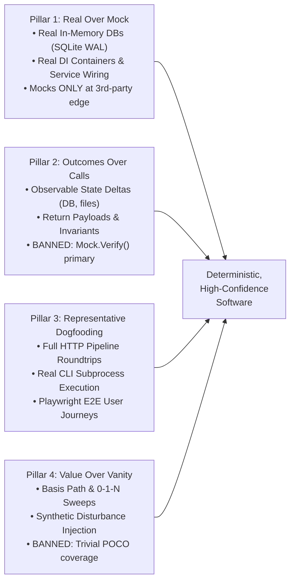
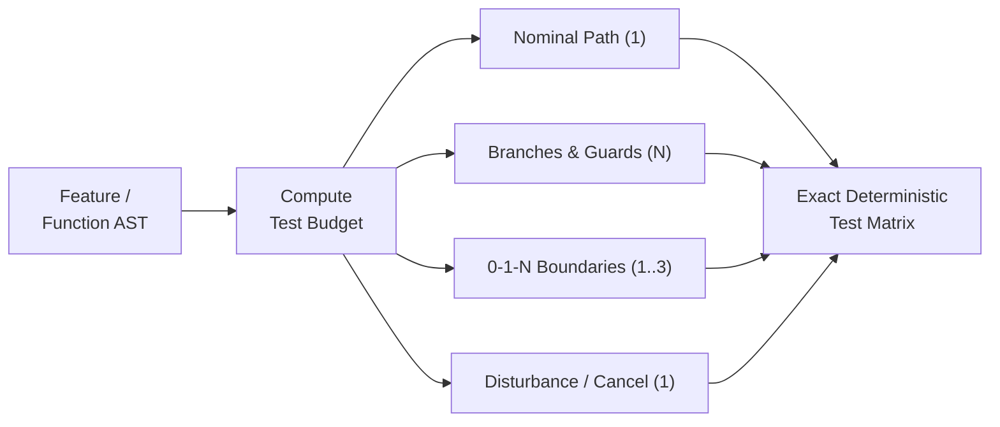
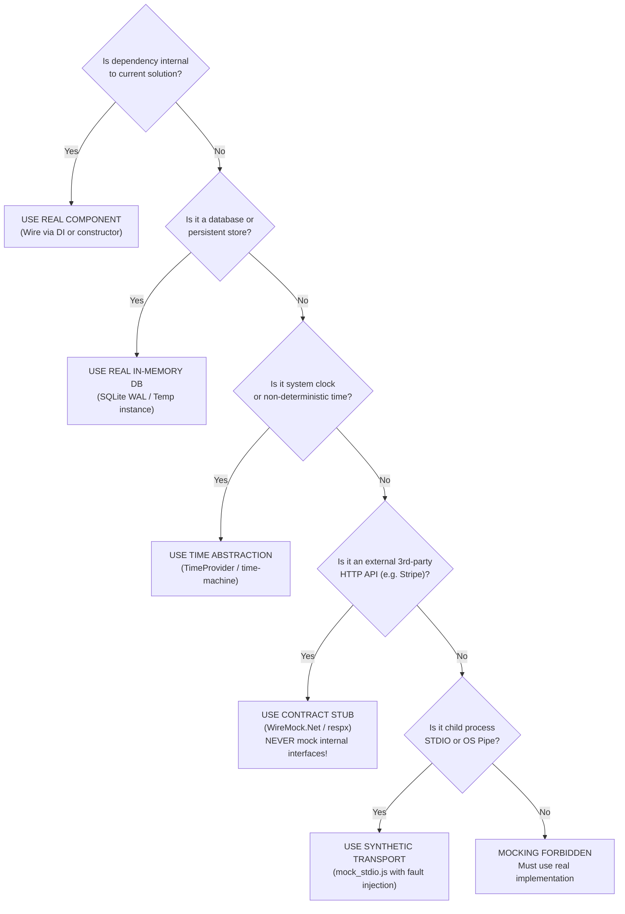
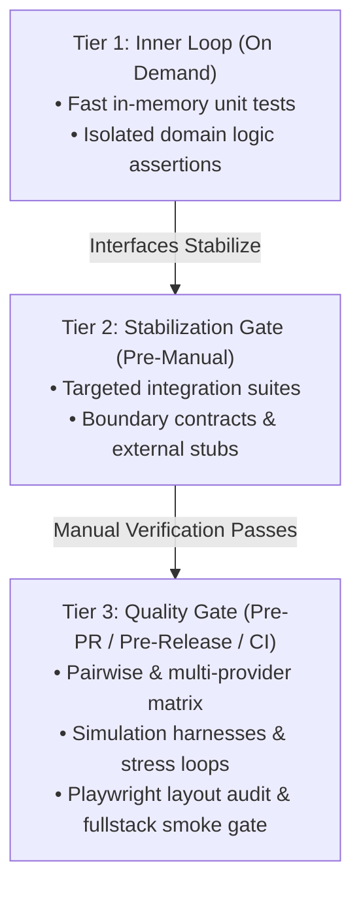

# Simulation and Control Harnesses: Observation, Testing, and Feedback

This guide defines simulation architecture, test harness conventions, and closed-loop verification practices. These practices guarantee software stability, deterministic performance, and **≥ 80% code coverage**.

---

## Observable Dynamic Systems and The Four Pillars

### Software as a Dynamic System

Software operates as a closed-loop dynamic system:
1. **Observable States**: Systems expose internal states through diagnostic tap points, metrics, and health probes.
2. **High-Volume and Parameter Sweeps**: Test harnesses simulate high-throughput stress, batch processing, and parameter sweeps to evaluate numeric stability and boundary limits.
3. **Disturbance Ingestion**: Systems process imperfect inputs, synthetic latency, and abrupt disconnects to prove graceful recovery.
4. **Closed-Loop Feedback**: Tests capture state responses, compute deltas, and return structured diagnostic envelopes for rapid developer and AI self-correction.

### The Four Pillars of Anti-Test Theatre

In fast engineering environments, automated test suites often degrade into **"Test Theatre"**:
- **Mock-Heavy Tautologies**: Agents construct elaborate mocks of internal domain interfaces. Tests verify that mocks were called rather than asserting state mutations.
- **Coverage Chasing Without Representation**: Suites achieve high line coverage by asserting trivial constructors and property getters while missing real boundary failures.
- **Fragile Scaffolding vs. Real Deficiencies**: Tests break whenever implementation details refactor, yet fail to catch critical regressions.

The **Four Pillars of Anti-Test Theatre** eliminate test theatre (see also [Ban on Mock-Heavy Test Theatre](/standards/engineering-style-guide#ban-on-mock-heavy-test-theatre)):



#### Pillar 1: Real Implementations Over Synthetic Mocks

- Test software using real components and authentic in-memory equivalents rather than synthetic mocks.
- Use SQLite in WAL mode with real schema migrations and Dapper queries instead of mocking `IRepository<T>` or `DbContext`.
- **Strict Boundary Rule**: Never mock internal domain services, business logic, or local storage.
- Permit mocks **only** at unmanageable external third-party network boundaries (such as Stripe, SendGrid, or OAuth providers) when local containers or stubs are unavailable.

#### Pillar 2: Observable State and Behavioral Assertions

- Evaluate observable outcomes in assertions: updated database records, generated files, API response payloads, emitted domain events, or state machine transitions.
- **Banned Assertion**: Never verify mock invocation counts (such as `mock.Verify(x => x.Save(), Times.Once)`) as the primary proof of functionality.
- Assert data mutations directly in the persistent data store or response payload.

#### Pillar 3: Mandatory Representative Dogfooding

- Execute a representative end-to-end journey or CLI/API roundtrip for every feature before claiming completion.
- Execute CLI commands via a real subprocess against temporary files.
- Execute API endpoints through a full HTTP request-response cycle across the entire middleware stack.

#### Pillar 4: Value-Driven Testing Over Numeric Vanity

- Do not write tests for boilerplate POCOs, DTOs, record constructors, or auto-properties merely to inflate coverage percentages.
- Prioritize boundary conditions, edge cases, synthetic disturbances (socket disconnects, malformed inputs, timeouts), and concurrency.
- Focus test budgets strictly on domain logic, calculation rules, edge cases, state transitions, and integration boundaries.

---

## Banned and Mandated Patterns Matrix

The following three matrices establish strict verification standards across twelve engineering dimensions. They classify common testing shortcuts as banned test theatre and define mandated engineering alternatives.

### Data, Service Wiring, Assertions, and Web APIs

| Dimension | Banned Anti-Pattern (Test Theatre) | Mandated Engineering Standard (Real Verification) |
| :--- | :--- | :--- |
| **1. Data Access & Persistence** | • Mocking `IRepository<T>` or `DbContext` to return hardcoded arrays.<br>• Asserting that `ExecuteAsync` received a specific SQL string.<br>• Ignoring database constraints (foreign keys, nullability, unique indexes). | • Execute real Dapper queries and migrations against an in-memory SQLite (WAL mode) database.<br>• Assert database state transitions directly (insert, mutate, query back, verify constraints and rollbacks). |
| **2. Service Wiring & Composition** | • Constructing services with 6+ mocked constructor parameters.<br>• Verifying internal method call chains rather than component behavior. | • Wire real dependencies through the application DI container (`ServiceCollection` / `TestServiceProvider`).<br>• Exercise the domain workflow end-to-end and verify system state deltas. |
| **3. Assertion Quality & Semantics** | • Asserting mock invocations (`mock.Verify`) as the sole proof of success.<br>• Using vague assertions (`Assert.NotNull(result)`, `len(items) > 0`).<br>• Computing expected values with the same buggy helper under test. | • Assert concrete state and schema invariants (`Assert.Equal("Shipped", order.Status)`).<br>• Capture exact `output_delta` payloads using the [Six-Part Agent Feedback Envelope](#the-six-part-agent-feedback-envelope).<br>• Verify observable side effects (emitted channel events, committed rows). |
| **4. HTTP & Web APIs** | • Instantiating API Controllers directly (`new ApiController(mocks...)`) and calling action methods as plain functions.<br>• Mocking middleware, authentication filters, or JSON serialization. | • Execute full HTTP roundtrips using `WebApplicationFactory<Program>` (.NET) or `httpx.AsyncClient` (Python).<br>• Validate routing, model binding, auth handlers, JSON serializers, and error handling together. |

### CLI, Async Channels, Faults, and Test Fixtures

| Dimension | Banned Anti-Pattern (Test Theatre) | Mandated Engineering Standard (Real Verification) |
| :--- | :--- | :--- |
| **5. CLI & Console Applications** | • Mocking `Console.ReadLine` or `sys.stdin` with fake memory streams.<br>• Asserting exit code `0` without inspecting output files or state. | • Execute real CLI binaries via subprocess execution or `System.CommandLine` test invocation in isolated temporary workspaces.<br>• Assert exact exit codes, `stdout`/`stderr` formatting, and filesystem side effects. |
| **6. Async, Channels & Daemons** | • Calling `Thread.Sleep(500)` or `asyncio.sleep(1)` to wait for background workers.<br>• Mocking `Channel<T>` or background workers out of the test loop. | • Use deterministic synchronization (`Channel<T>.Reader.WaitToReadAsync`, `ManualResetEventSlim`, or bounded polling with cancellation).<br>• Drain in-memory queues and verify worker retry and cancellation cleanup. |
| **7. Error Handling & Fault Injection** | • Writing happy-path-only tests where failures are never simulated.<br>• Forcing a mock to throw generic exceptions that the real system never produces. | • Inject synthetic disturbances: malformed JSON payloads, abrupt process termination (`mock_stdio.js`), socket timeouts, and invalid auth tokens.<br>• Verify graceful degradation, standardized error payloads, and audit logs. |
| **8. Test Data & Fixtures** | • Using unseeded random test data that causes non-deterministic failures.<br>• Copying fragile 1,000-line JSON fixtures with 90% unused fields. | • Use deterministic test data builders with explicit random seeds.<br>• Specify only the fields relevant to the test scenario and rely on valid domain defaults for the rest. |

### Boilerplate, UI Audits, Configuration, and Network Edges

| Dimension | Banned Anti-Pattern (Test Theatre) | Mandated Engineering Standard (Real Verification) |
| :--- | :--- | :--- |
| **9. Trivial & Boilerplate Testing** | • Testing auto-properties, C# record constructors, DTO getters, or enum mappings purely to boost line coverage.<br>• Writing 20 tests for a 1-line pass-through function. | • Do not write tests for boilerplate POCOs, DTOs, or auto-properties.<br>• Focus test budgets strictly on domain logic, calculation rules, edge cases, state transitions, and integration boundaries. |
| **10. UI & Frontend Verification** | • Mocking every child component and hook to an empty `<div>` in shallow unit tests.<br>• Snapshot testing massive DOM trees that developers blindly update (`-u`). | • Run Playwright end-to-end journey tests against the live frontend and backend.<br>• Enforce the 4-point `playwright-layout-inspector` audit (zero overflow, mobile fit, ≥ 24px touch targets, layout score ≥ 85). |
| **11. Configuration & Environments** | • Mocking `IConfiguration` with fake in-memory dictionaries.<br>• Writing tests that depend on hardcoded local machine paths. | • Test configuration binding using real `appsettings.json` or `.env` loading with temporary isolated overlays.<br>• Verify fallback behavior when required configuration keys are missing or invalid. |
| **12. Third-Party Network Boundaries** | • Hand-rolling complex mock behaviors that drift away from real third-party API contracts.<br>• Making live outbound network requests during automated test runs. | • Use WireMock.Net (.NET) or `respx` / `vcrpy` (Python) to replay recorded HTTP interactions or validate request contracts.<br>• Restrict test doubles strictly to external network edges; never mock internal service boundaries. |

---

## Deterministic Testing Protocols for AI Agents

To eliminate guesswork, agents execute two deterministic protocols before authoring test suites (automated via the [`test-harness-builder` skill](/rules/skills#test-harness-builder-skill)):

### Deterministic Test Budget Formula

Analyze the target function or feature Abstract Syntax Tree (AST) to compute the exact required test suite budget:

```text
Test Budget = 1 (Nominal) + N_Branches + N_Boundaries (0-1-N) + N_Disturbances
```

1. **Nominal Path (1 test)**: Write exactly one test exercising the happy path with valid nominal data.
2. **Decision and Guard Branches (1 test per branch)**: Write one test per independent branch (`if`, `switch`, validation guard, or explicit `throw`).
3. **0-1-N Boundary Conditions (1 to 3 tests)**:
   - `0`: Empty collection, null parameter, or zero value.
   - `1`: Single element or minimum boundary threshold.
   - `N`: Large collection, maximum boundary, or pagination limit.
4. **Disturbances and Lifecycle (1 test if async or stateful)**:
   - For asynchronous methods: write one test validating `CancellationToken` propagation or timeout recovery.
   - For state mutations: write one test validating idempotency.



### Deterministic Five-Question Mock Decision Tree

Pass every candidate dependency through this 5-question decision tree before creating any mock or stub:

1. **Is the dependency internal to the current solution?** If yes, use the real component via dependency injection or direct instantiation.
2. **Is it a database or persistent store?** If yes, use a real in-memory database (SQLite WAL or ephemeral instance).
3. **Is it the system clock or non-deterministic time?** If yes, use a time abstraction (`TimeProvider` or `time-machine`).
4. **Is it an external third-party HTTP API (such as Stripe or SendGrid)?** If yes, use a contract stub (`WireMock.Net` or `respx`). Never mock internal interfaces.
5. **Is it child process STDIO or an OS pipe?** If yes, use a synthetic transport (`mock_stdio.js`) with fault injection.

If you answer **"No"** to all five questions, **mocking is forbidden**. Use the real implementation.



---

## Tiered Testing Cadence

Running slow integration suites during early exploratory prototyping stalls momentum. Follow the three-tier testing cadence:



### Tier 1: Inner Loop and Rapid Development

- Execute fast, isolated in-memory unit tests on demand.
- Do not mandate full test runs while drafting early prototypes or mutating internal contracts.
- Focus on rapid feedback for core algorithms, data transformations, and pure functions.

### Tier 2: Stabilization Gate Before Manual Verification

- Trigger once feature interfaces, API signatures, and data boundaries stabilize.
- Run unit test suites and targeted integration harnesses immediately before manual developer or agent testing.
- Catch contract regressions before spending manual verification time.

### Tier 3: Pre-PR, Pre-Release, and CI Quality Gate

- Execute the full test matrix, multi-provider integration suites, and high-volume simulation harnesses.
- Run Playwright layout audits across mobile and desktop viewports.
- Enforce the **≥ 80% code coverage** target and zero linter warnings across all [CI/CD Pipeline Stages](/standards/ci-cd-pipelines#stage-descriptions).

---

## When to Build a Dedicated Simulation Harness

### Architectural Boundary Crossings

Build a dedicated simulation harness whenever an external API, relational database, child process STDIO pipe, Server-Sent Events (SSE) stream, or network socket enters the system architecture.

### Tunable Algorithms and Stateful Daemons

Build a simulation harness whenever:
- **Tunable Algorithms**: Logic includes numeric convergence, thresholding, sorting, or scoring that requires parameter sweeping.
- **Stateful Daemons**: Systems manage background workers, producer-consumer queues (`Channel<T>`), or multi-step transaction pipelines.

---

## Harness Types and Simulation Patterns

### High-Volume and Stress Loop Harness

Wrap the component under test in a high-volume execution loop that feeds batches of synthetic or recorded inputs:

```csharp
// Example: High-Volume C# Closed-Loop Harness
public class HighVolumeSimulationHarness
{
    private readonly IProcessingEngine _engine;

    public async Task<HarnessResult> RunBatchAsync(int batchSize, CancellationToken ct)
    {
        var transitions = new List<StateTransition>();
        var sw = Stopwatch.StartNew();

        for (int i = 0; i < batchSize; i++)
        {
            var payload = GenerateSyntheticPayload(i);
            var result = await _engine.ProcessAsync(payload, ct);
            transitions.Add(new StateTransition(i, result.State, sw.ElapsedMilliseconds));
        }

        return new HarnessResult(batchSize, transitions, sw.Elapsed);
    }
}
```

### Synthetic Mock Transports (`mock_stdio.js`)

Simulate child process STDIO with controllable latency, output buffering, error stream emission, and abrupt process termination:

```javascript
// mock_stdio.js - Simulates asynchronous JSON-RPC communication & disconnects
const readline = require('readline');
const rl = readline.createInterface({ input: process.stdin, output: process.stdout, terminal: false });

rl.on('line', (line) => {
  try {
    const req = JSON.parse(line);
    if (req.method === 'trigger_disconnect') {
      process.exit(1); // Abrupt crash to test reconnection
    }
    setTimeout(() => {
      if (req.method === 'ping') {
        console.log(JSON.stringify({ jsonrpc: '2.0', id: req.id, result: 'pong' }));
      }
    }, 50);
  } catch (err) {
    process.stderr.write(`Malformed JSON: ${line}\n`);
  }
});
```

### Synthetic Disturbance Injection

Inject failures specifically to verify error fallbacks and graceful degradation:
- **Malformed Payloads**: Feed corrupt JSON, truncated strings, and invalid encodings.
- **Abrupt Disconnects**: Terminate child processes or socket streams mid-handshake to verify `CancellationToken` cleanup and retry logic.
- **Latency Spikes**: Inject artificial delays to verify timeout thresholds and circuit breakers.

---

## Diagnostic Tap Points and Agent Introspection

### Development Tap Point Protocol

Follow three steps during development and debugging:
1. **Inject Hooks**: Add internal diagnostic hooks (event subscriptions, state snapshot getters, and in-memory ring buffers).
2. **Inspect Internals**: Subscribe test harnesses to these hooks to assert internal state transitions without parsing unstructured text logs.
3. **Clean Up**: Remove or compile-guard temporary debug hooks before production release.

---

## UI Layout Stability and Ergonomics Auditing

### Four-Point Layout Inspector Rules

Frontend applications integrate **`playwright-layout-inspector`** alongside `data-testid` attributes to enforce four mandatory visual and ergonomic checks (see [React, TypeScript & Vite UI Archetype](/archetypes/react-ts-vite-ui#representative-test-harness-playwright-and-layout-audit)):
1. **Zero Horizontal Overflow**: `toHaveNoLayoutOverflow()` verifies zero unintended horizontal scrollbars or element bleed.
2. **Mobile Viewport Fit**: `toHaveMobileFit()` verifies responsive scaling on mobile viewports.
3. **Touch Target Ergonomics**: `toHaveTouchFriendlyTargets({ minSize: 24 })` verifies interactive targets measure **≥ 24px**.
4. **Composite Layout Score**: `toPassLayoutAudit({ minScore: 85 })` verifies an overall layout health score of **≥ 85**.

### Playwright Layout Audit Implementation

```typescript
import { test, expect } from '@playwright/test';
import 'playwright-layout-inspector/matchers';

test.describe('Responsive Layout & Ergonomics Audit', () => {
  test('audit page layout across viewports', async ({ page }) => {
    await page.goto('/');

    // 1. Assert zero unwanted horizontal scrollbars or element bleed
    await expect(page).toHaveNoLayoutOverflow();

    // 2. Assert mobile viewport & zoom readiness
    await expect(page).toHaveMobileFit();

    // 3. Assert touch targets meet WCAG standards (>= 24px)
    await expect(page).toHaveTouchFriendlyTargets({ minSize: 24 });

    // 4. Assert overall layout UX score is Grade A (>= 85)
    await expect(page).toPassLayoutAudit({ minScore: 85 });
  });
});
```

---

## The Six-Part Agent Feedback Envelope

### Required Diagnostic Fields

When a test harness, integration test, or simulation loop fails, package the failure output into a standardized 6-part JSON envelope so developers and AI agents can reproduce and diagnose the root cause deterministically:
1. **`inputs`**: Raw parameters, batch sizes, and random seeds fed to the harness.
2. **`assumptions`**: Environmental preconditions expected by the test run.
3. **`active_settings`**: Active configuration values, timeouts, and database pragmas.
4. **`action_history`**: Ordered sequence of steps and state transitions leading up to the failure.
5. **`output_delta`**: Structured comparison of expected vs. actual outcomes.
6. **`captured_logs` & `reproduction_command`**: Ring-buffer error logs and the exact CLI command required to reproduce the failure.

### Diagnostic Payload Example

```json
{
  "status": "FAILED",
  "test_name": "Test_HighThroughput_OrderBatch_Convergence",
  "inputs": {
    "batch_size": 1000,
    "concurrency_limit": 16,
    "seed": 42
  },
  "assumptions": [
    "Database connection pool size >= 20",
    "Channel buffer capacity >= 500"
  ],
  "active_settings": {
    "journal_mode": "WAL",
    "synchronous": "NORMAL",
    "busy_timeout": 5000
  },
  "action_history": [
    { "step": 1, "action": "SpawnWorkerPool", "status": "OK" },
    { "step": 2, "action": "Enqueue500Items", "status": "OK" },
    { "step": 3, "action": "SimulateDisconnect", "status": "TRIGGERED" },
    { "step": 4, "action": "DrainChannel", "status": "TIMEOUT" }
  ],
  "output_delta": {
    "expected_processed": 500,
    "actual_processed": 482,
    "unprocessed_delta": 18
  },
  "captured_logs": [
    "ERROR [Worker-3] CancellationTokenSource timed out after 5000ms",
    "WARN [Pool] Connection dropped during transaction commit"
  ],
  "reproduction_command": "dotnet test --filter \"FullyQualifiedName=Harness.Test_HighThroughput\" -- --seed 42"
}
```

---

## Polyglot Archetype Test Harness Recipes

The following recipes demonstrate representative verification harnesses across our five supported polyglot archetypes.

### C# (.NET 10) Fullstack and CLI

See the [Fullstack (.NET + React) Archetype](/archetypes/fullstack-dotnet-react#testing-and-simulation-harnesses) and [.NET Console & CLI Archetype](/archetypes/console-cli-dotnet#representative-subprocess-test-harness) for complete project layouts.

#### Web API Integration Harness (`WebApplicationFactory` + In-Memory SQLite)

```csharp
public class ApiIntegrationTestBase : WebApplicationFactory<Program>
{
    private SqliteConnection _keepAliveConnection;

    protected override void ConfigureWebHost(IWebHostBuilder builder)
    {
        builder.ConfigureServices(services =>
        {
            var descriptor = services.SingleOrDefault(d => d.ServiceType == typeof(IDbConnectionFactory));
            if (descriptor != null) services.Remove(descriptor);

            _keepAliveConnection = new SqliteConnection("Data Source=:memory:;Mode=Memory;Cache=Shared");
            _keepAliveConnection.Open();

            services.AddSingleton<IDbConnectionFactory>(new SqliteConnectionFactory(_keepAliveConnection));

            var sp = services.BuildServiceProvider();
            var migrator = sp.GetRequiredService<IDatabaseMigrator>();
            migrator.MigrateUp();
        });
    }

    protected override void Dispose(bool disposing)
    {
        _keepAliveConnection?.Dispose();
        base.Dispose(disposing);
    }
}
```

#### CLI Execution Fixture

```csharp
public class CliExecutionHarness : IDisposable
{
    public string TempWorkspace { get; } = Path.Combine(Path.GetTempPath(), Path.GetRandomFileName());

    public CliExecutionHarness() => Directory.CreateDirectory(TempWorkspace);

    public async Task<(int ExitCode, string StdOut, string StdErr)> ExecuteAsync(params string[] args)
    {
        var psi = new ProcessStartInfo("dotnet", string.Join(" ", args))
        {
            WorkingDirectory = TempWorkspace,
            RedirectStandardOutput = true,
            RedirectStandardError = true
        };
        using var proc = Process.Start(psi)!;
        var stdout = await proc.StandardOutput.ReadToEndAsync();
        var stderr = await proc.StandardError.ReadToEndAsync();
        await proc.WaitForExitAsync();
        return (proc.ExitCode, stdout, stderr);
    }

    public void Dispose() => Directory.Delete(TempWorkspace, recursive: true);
}
```

### Python (3.12+) FastAPI and FastMCP

See the [Python FastAPI & FastMCP Archetype](/archetypes/python-fastapi-mcp#testing-cadence-and-representative-recipes) for complete service and wrapper conventions.

#### ASGI In-Memory Transport with SQLite

```python
import pytest
from httpx import ASGITransport, AsyncClient
from app.main import app
from app.database import init_db

@pytest.fixture
async def client(tmp_path):
    test_db = f"sqlite+aiosqlite:///{tmp_path}/test.db"
    await init_db(test_db)
    
    transport = ASGITransport(app=app)
    async with AsyncClient(transport=transport, base_url="http://test") as ac:
        yield ac
```

#### FastMCP In-Memory Session Client

```python
import pytest
from mcp.client.inmemory import InMemorySessionClient
from app.mcp_server import mcp

@pytest.mark.asyncio
async def test_mcp_tool_execution():
    async with InMemorySessionClient(mcp) as session:
        result = await session.call_tool("calculate_metrics", arguments={"sample_rate": 100})
        assert result.content[0].text is not None
        assert "convergence_score" in result.content[0].text
```

### TypeScript and React (Vite)

See the [React, TypeScript & Vite UI Archetype](/archetypes/react-ts-vite-ui#representative-test-harness-playwright-and-layout-audit) for store and component structure.

#### Playwright E2E User Journey and Layout Inspection

```typescript
import { test, expect } from '@playwright/test';
import 'playwright-layout-inspector/matchers';

test.describe('Order Management User Journey', () => {
  test('operator can submit order and view updated table', async ({ page }) => {
    await page.goto('/');

    await page.getByTestId('sku-input').fill('SKU-999');
    await page.getByTestId('quantity-input').fill('10');
    await page.getByTestId('submit-order-btn').click();

    const row = page.getByTestId('order-row-SKU-999');
    await expect(row).toBeVisible();
    await expect(row.getByTestId('order-status')).toHaveText('Pending');

    // 4-Point Ergonomics & Layout Audit
    await expect(page).toHaveNoLayoutOverflow();
    await expect(page).toHaveMobileFit();
    await expect(page).toHaveTouchFriendlyTargets({ minSize: 24 });
    await expect(page).toPassLayoutAudit({ minScore: 85 });
  });
});
```

### C++ (C++20/23) Native Algorithms

See the [Modern C++ Native Systems Archetype](/archetypes/native-cpp-algorithms#representative-test-harness-parameter-sweeps) for CMake, `vcpkg`, and C-ABI interop patterns.

#### Parameter Sweeps and Boundary Stress Harness

```cpp
#include <gtest/gtest.h>
#include "numerical_solver.hpp"

class SolverBoundaryTest : public ::testing::TestWithParam<std::tuple<double, double, int>> {};

TEST_P(SolverBoundaryTest, ConvergesWithinToleranceUnderDisturbance) {
    auto [initial_value, learning_rate, max_iterations] = GetParam();
    
    SolverConfig config{.lr = learning_rate, .max_iter = max_iterations};
    NumericalSolver solver(config);

    auto result = solver.Solve(initial_value);

    EXPECT_TRUE(result.converged);
    EXPECT_LT(std::abs(result.residual), 1e-6);
    EXPECT_LE(result.iterations_taken, max_iterations);
}

INSTANTIATE_TEST_SUITE_P(
    BoundarySweeps,
    SolverBoundaryTest,
    ::testing::Combine(
        ::testing::Values(-1e5, -1.0, 0.0, 1.0, 1e5),
        ::testing::Values(0.001, 0.01, 0.1),
        ::testing::Values(10, 100, 1000)
    )
);
```
