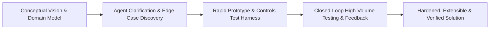
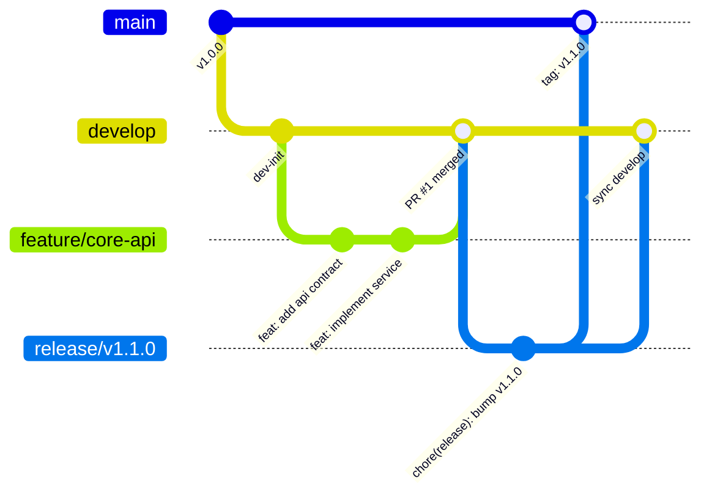
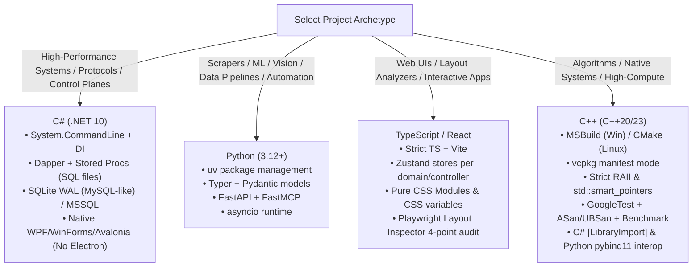
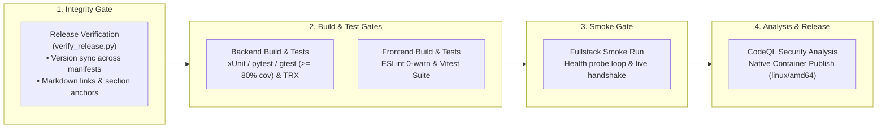

# Master Engineering Style Guide and Architecture Archetype

This document codifies the core engineering principles, architectural patterns, polyglot language standards, test harness conventions, and living documentation practices established across Steven T. Pelech's repositories and agent workflows.

---

## Collaboration and Iterative Design Model

### Vision and Proactive Clarification

Steven drives the conceptual vision, architecture, and feature ideas. Because ideas start conceptually and evolve during design, **the agent must ask insightful clarifying questions** to define requirements, edge cases, and design constraints before or during development.

### Rapid Prototyping and Closed-Loop Learning

Build software through rapid prototyping and closed-loop evaluation. Prototype early, run simulation harnesses, learn from live system behavior, and refine the architecture iteratively.

### Traditional Git Flow Discipline

Adopt traditional Git Flow across all repositories:
- **`main`**: Production tagged releases only (`vX.Y.Z`). Every commit represents a verified release. Direct pushes are forbidden.
- **`develop`**: Primary integration branch for ongoing work. Merge feature branches here through Pull Requests.
- **`feature/*`**: Dedicated branches created off `develop` (`feature/feature-name`) for isolated functional work. Merge back to `develop` after Tier 2 and Tier 3 quality gates pass.
- **`release/*`**: Branches created off `develop` (`release/vX.Y.Z`) when features freeze for an upcoming release. Use for version bumping, changelog finalization, and release verification before merging into `main` and syncing back to `develop`.
- **`hotfix/*`**: Branches created directly off `main` (`hotfix/vX.Y.Z`) to fix critical production defects. Merge into both `main` (with a release tag) and `develop`.

Commit all work using fine-grained, atomic **Conventional Commits** (`feat:`, `fix:`, `test:`, `docs:`, `chore:`). Every merge requires a Pull Request where all [Multi-Stage CI/CD Pipeline](CI_CD_PIPELINES.md#git-flow-trigger-matrix) gates pass.

---

## Foundational Engineering Principles

### SOLID and Modularity

1. **Single Responsibility**: Give each class, module, and component a single, well-defined reason to change.
2. **File Size Limit**: Keep classes and source files at or below **500 lines of code (≤ 500 LOC)**. Decompose larger files into focused partial classes, sub-services, or domain helpers.
3. **Open and Closed**: Design modules for pluggability and extensibility without modifying core engine logic.
4. **Interface Segregation**: Define narrow, role-focused interfaces (`IStateReader`, `IStateWriter`, `IHealthCheckable`) instead of monolithic interfaces.
5. **Dependency Inversion**: Depend on abstractions rather than concrete implementations. Build interfaces (`I*`) even for single implementations to guarantee testability and loose coupling.

### DRY, YAGNI, and KISS

1. **Rule of Three for DRY**: Permit duplication across two instances when contexts or data shapes differ slightly. Refactor into a shared utility on the **third occurrence**.
2. **YAGNI (You Aren't Gonna Need It)**: Do not build speculative multi-tier frameworks, premature plugin registries, or unused generic abstractions.
3. **KISS (Keep It Simple, Stupid)**: Choose direct, readable implementations over complex indirection.

### Semantic Naming and Anti-Pattern Bans

1. **Ban Junk-Drawer Classes**: Never create catch-all class names such as `GeneralManager`, `AppHelper`, `DataUtil`, or `CommonHandler`.
2. **Role- and Verb-Based Naming**:
   - **Services and Handlers**: Name strictly by role or action (`DatabaseSeederService`, `UserAuthenticator`, `OrderProcessor`, `StateTransitionLogger`).
   - **Interfaces**: Prefix C# interfaces with `I` (`IDbConnectionFactory`, `ITransportChannel`). Use descriptive role names or `*able` traits in TypeScript and Python.
   - **UI Components**: Name strictly after the visual entity or view role (`ServerStatusCard`, `DeviceListTable`, `HeaderNavbar`). Never name components after temporary features or git branches.
   - **Zustand Stores**: Prefix store filenames and hooks with `use*Store.ts` (`useAuthStore.ts`, `useServerStore.ts`).

### Ban on Mock-Heavy Test Theatre

- Never write mock-heavy unit tests without authentic integration verification.
- Do not mock domain repositories, business services, or internal interfaces.
- Do not assert mock invocations (such as `mock.Verify()`) as primary proof of behavior; assert observable state mutations instead.
- Follow the [Four Pillars of Anti-Test Theatre](TESTING_HARNESS_PATTERNS.md#the-four-pillars-of-anti-test-theatre) and the [Banned and Mandated Patterns Matrix](TESTING_HARNESS_PATTERNS.md#banned-and-mandated-patterns-matrix).

### Performance and Efficiency Discipline

1. **Database Round-Trips**: Consolidate operations requiring three or more database round-trips or multi-table joins into a single **Stored Procedure** or batch query.
2. **Frontend Re-renders**: Use **granular Zustand selectors** (`useServerStore(s => s.serverCount)`) to prevent unnecessary component re-renders.
3. **API Independence**: Expose focused REST or HTTP endpoints so UI components and stores can manage their own data lifecycles independently.

### Error Handling and Diagnostics

1. **Protect Internal Stacks**: Never leak raw stack traces or database schemas to clients. Return structured error payloads with correlation IDs.
2. **Domain Exceptions vs. Validation Results**: Use domain exceptions for unexpected system failures and Result or boolean patterns for expected validation failures.
3. **Reproducible Debug Payloads**: Log the error description, stack trace, and exact input payload or state that triggered the failure.

### APIs First, MCP Later

1. **Foundational Domain APIs**: Implement business logic, data models, validation, and security inside typed, first-class APIs (ASP.NET Core Minimal APIs or Controllers, FastAPI endpoints, C++ native libraries, or CLI commands).
2. **Thin MCP Adapters**: Expose Model Context Protocol (MCP) tools strictly as lightweight adapter layers that delegate to hardened domain APIs or services.
3. **Architectural Isolation**: Exercise and verify core APIs directly via HTTP, CLI, or in-memory calls without requiring an active LLM or MCP runtime.

---

## Polyglot Language and Archetype Standards

### Curated Archetype Guides

| Archetype | Target Systems | Reference Blueprint |
| :--- | :--- | :--- |
| **Fullstack (.NET + React + SQL)** | Control planes, web platforms, high-concurrency services | [Fullstack Archetype Guide](../archetypes/fullstack-dotnet-react.md) |
| **C# Console & CLI** | Command-line utilities, batch workers, background daemons | [.NET CLI Archetype Guide](../archetypes/console-cli-dotnet.md) |
| **Python FastAPI & FastMCP** | Data pipelines, AI/ML services, APIs First + MCP servers | [Python FastAPI & FastMCP Guide](../archetypes/python-fastapi-mcp.md) |
| **React, TypeScript & Vite UI** | Standalone dashboards, monitoring portals, interactive apps | [React TS Vite UI Guide](../archetypes/react-ts-vite-ui.md) |
| **Modern C++ Native Systems** | Numerical solvers, geometry engines, native C#/Python interop | [C++ Native Archetype Guide](../archetypes/native-cpp-algorithms.md) |

---

## Backend Architecture and Persistence

### .NET 10 Solution and API Routing

- **Project Structure**: Use the `.slnx` solution format with `<Nullable>enable</Nullable>`, `<ImplicitUsings>enable</ImplicitUsings>`, and a root `Directory.Build.props`.
- **Minimal APIs**: Reserve for small services, simple feed-through routes, lightweight vertical slices, and streaming endpoints.
- **Controllers (`[ApiController]`)**: Use for larger control planes, multi-route resources, admin portals, and distinct domain slices.

### Relational Persistence and SQLite WAL

- Store complex SQL inside dedicated `.sql` stored procedure files rather than inline C# strings.
- Use idempotent schema migrations and seeders (`DatabaseSeederService.cs`).
- Design SQLite schemas with relational types compatible with MySQL and MS SQL to simplify container migration.
- Enforce mandatory SQLite WAL pragmas on connection open:
  `PRAGMA journal_mode = WAL; PRAGMA synchronous = NORMAL; PRAGMA busy_timeout = 5000; PRAGMA foreign_keys = ON;`

### Configuration, Authentication, and Encryption

- Use `appsettings.json` with environment variable overrides as the primary configuration source.
- Support forward authentication headers (`Remote-User`, `Remote-Groups`) for human web traffic and **Bearer tokens** for machine or agent traffic.
- Encrypt sensitive data at rest using self-contained **AES-256-GCM** symmetric encryption rather than OS-locked DPAPI or external vault dependencies.

### Concurrency, Channels, and Resilience

- Use `ConcurrentDictionary` for thread-safe in-memory lookups and caches.
- Use `System.Threading.Channels.Channel<T>` for high-throughput producer-consumer pipelines.
- Use `SemaphoreSlim` for asynchronous synchronization and `Interlocked` for atomic counters.
- Propagate `CancellationToken` across 100% of asynchronous database, I/O, and streaming calls.
- Expose an unauthenticated `/health` endpoint on every web service.

---

## Frontend Architecture

### React, TypeScript, and Vite Stack

- Build frontends with React and TypeScript in strict mode (`"strict": true`), bundled with Vite.
- Organize directories by domain and view role (`components/common/`, `components/[ComponentName]/`, `hooks/`, `stores/`, `views/`).
- Use native **C# UI frameworks** (WPF, WinForms, or Avalonia) for desktop applications; never use Electron.

### Zustand State and Granular Selectors

- Partition **Zustand** stores into separate files mapped per domain or backend controller (`useServerStore.ts`, `useAuthStore.ts`).
- Mandate granular selector hooks (`const count = useServerStore(s => s.servers.length)`) to prevent component render cascades.
- Use lean native `fetch` wrappers by default instead of heavy external query libraries.
- Style components with pure CSS Modules and theme variables (`theme.css`).

### Automated UI Layout Quality Gates

- Attach `data-testid` attributes to interactive UI elements for automated browser verification.
- Enforce the 4-point `playwright-layout-inspector` audit across mobile and desktop viewports (see [UI Layout Stability and Ergonomics Auditing](TESTING_HARNESS_PATTERNS.md#ui-layout-stability-and-ergonomics-auditing)):
  1. `expect(page).toHaveNoLayoutOverflow()` (zero horizontal bleed)
  2. `expect(page).toHaveMobileFit()` (responsive viewport scaling)
  3. `expect(page).toHaveTouchFriendlyTargets({ minSize: 24 })` (touch target sizing ≥ 24px)
  4. `expect(page).toPassLayoutAudit({ minScore: 85 })` (composite layout score ≥ 85)

---

## Testing and Simulation Harnesses

### Observable Systems and Controls Mindset

Treat software as an observable dynamic system that requires state inspection, actuation, and closed-loop feedback. Build dedicated simulation harnesses whenever crossing a network or process boundary, managing stateful protocols, or tuning algorithmic parameters.

### Anti-Test Theatre and Deterministic Budgets

- Verify real system behaviors and observable state mutations rather than mock tautologies.
- Follow the [Four Pillars of Anti-Test Theatre](TESTING_HARNESS_PATTERNS.md#the-four-pillars-of-anti-test-theatre) and the 12-dimension [Banned and Mandated Patterns Matrix](TESTING_HARNESS_PATTERNS.md#banned-and-mandated-patterns-matrix).
- Compute required test suite size using the [Deterministic Test Budget Formula](TESTING_HARNESS_PATTERNS.md#deterministic-test-budget-formula):
  `Test Budget = 1 (Nominal) + Branches + Boundaries (0-1-N) + Disturbances`
- Evaluate every collaborator with the [Deterministic Five-Question Mock Decision Tree](TESTING_HARNESS_PATTERNS.md#deterministic-five-question-mock-decision-tree) before introducing any test double.
- Implement stack-specific integration fixtures using the [Polyglot Archetype Test Harness Recipes](TESTING_HARNESS_PATTERNS.md#polyglot-archetype-test-harness-recipes).

### Simulation Loops, Tap Points, and Disturbances

- **Diagnostic Tap Points**: Inject in-memory ring buffers and state snapshot listeners during development to inspect internal state transitions without log scraping (see [Diagnostic Tap Points](TESTING_HARNESS_PATTERNS.md#diagnostic-tap-points-and-agent-introspection)).
- **High-Volume Stress Loops**: Execute batch feeds, parameter sweeps, and convergence loops to uncover race conditions and memory leaks (see [Harness Types and Simulation Patterns](TESTING_HARNESS_PATTERNS.md#harness-types-and-simulation-patterns)).
- **Disturbance Injection**: Inject malformed payloads, synthetic latency, and abrupt disconnects to verify retry logic and `CancellationToken` teardown.

### Standardized Six-Part Feedback Envelope

Package all test harness or simulation loop failures into the [Six-Part Agent Feedback Envelope](TESTING_HARNESS_PATTERNS.md#the-six-part-agent-feedback-envelope):
1. **Inputs**: Raw parameters and random seeds fed to the harness.
2. **Assumptions**: Environmental preconditions expected by the test.
3. **Active Settings**: Configurations, pool limits, timeouts, and database pragmas.
4. **Action History**: Ordered sequence of state transitions preceding the failure.
5. **Output Delta**: Expected outcome vs. actual outcome delta.
6. **Captured Logs and Reproduction Command**: Ring-buffer logs and a deterministic CLI reproduction command.

### Tiered Testing Cadence and Coverage Target

Balance rapid prototyping speed with release reliability using the [Tiered Testing Cadence](TESTING_HARNESS_PATTERNS.md#tiered-testing-cadence):
- **Tier 1 (Inner Loop)**: Run fast, in-memory unit tests on demand during active development.
- **Tier 2 (Stabilization Gate)**: Run unit and targeted integration suites once interfaces stabilize, immediately before manual verification.
- **Tier 3 (Pre-PR & CI Gate)**: Execute the full test matrix, simulation stress loops, and Playwright layout audits before merging.
- **Coverage Target**: Maintain **≥ 80% code coverage** across unit, integration, and end-to-end suites, excluding trivial boilerplate POCOs and DTOs.

---

## Living Documentation and Automation

### Technical Writing and Style Standards

Write all user-facing documentation, README files, architectural blueprints, and living specifications according to our [Technical Writing Standards](../docs/standards/asd-ste100.md), combining **ASD-STE100 (Simplified Technical English)** and the **Google Developer Documentation Style Guide**:
- Keep sentences short and direct (**≤ 25 words per sentence**).
- Use active voice and second-person imperative mood for instructions.
- Organize content with scannable `H2` and `H3` headings, bulleted lists, and structured tables.
- Scope every cross-link to the exact target heading anchor (`#section-slug`) rather than linking vaguely across multiple headers.
- Use standard Unicode symbols (`≥`, `≤`) or plain words instead of unrendered LaTeX math syntax in prose.

### Mermaid Visual Diagrams and VitePress

- Author architectural, sequence, state, and branching diagrams using native **Mermaid syntax** (`flowchart TD`, `flowchart LR`, `sequenceDiagram autonumber`, `stateDiagram-v2`, `gitGraph`).
- Host living documentation with **VitePress** deployed to GitHub Pages, with both left-rail page/section navigation and right-rail (`H2`/`H3`) page outlines enabled.

### Repository Documentation and Release Scripts

- **`ARCHITECTURE.md`**: Contains the top-down Mermaid topology, sequence diagrams, subsystem breakdown, and documentation cross-linking map.
- **`README.md`**: Contains standardized status badges, system topology diagram, module catalog, and quickstart commands.
- **`commit.sh` & `verify_release.py`**: Automate build verification, SemVer synchronization, markdown link and anchor validation, and static anti-test-theatre audits.

---

## Four-Stage GitHub Actions CI/CD Pipeline

See the [Multi-Stage CI/CD Pipeline Blueprint](CI_CD_PIPELINES.md) for complete trigger rules and stage definitions.
